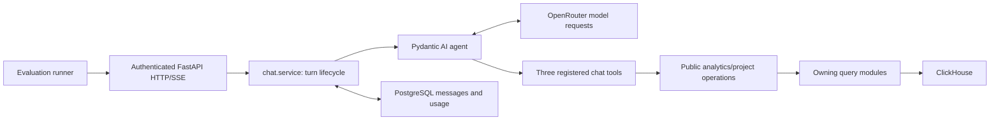

# From a completed response to an evidence-backed evaluation

**Team code walkthrough: 18 minutes, plus 2 minutes for questions**

Prepared from the actual checkout at `/home/maan3/vv/VV-git`, branch
`refactor/backend-domain-boundaries`, HEAD `76b08bd`. The tree was clean before
this presentation document was added. The implementation is in
[PR #1](https://github.com/Kian-Sham/VV/pull/1).

Audience assumption: engineers familiar with our backend, but not necessarily
Pydantic AI, OpenTelemetry, or LangSmith. The presentation uses source code and
recorded execution evidence. It does not require another live model run.

## Presenter setup

Start in `/home/maan3/vv/VV-git`. Keep this guide beside the editor. Open the files
as each stop is reached; follow the primary anchors rather than reading entire
modules. Line numbers below refer to `76b08bd` and may move in later revisions.
The spoken passages are prompts; the scheduled time includes inspecting code.

Use an editor and a terminal. The three rehearsed demo commands appear in the
appendix. Keep the existing private report available if the audience is authorized
to inspect raw evidence, but use the summary-only demo by default. Do not open
`.env.dev` or display complete trace/response files on a recorded screen.

The main message to repeat:

> “The system separates whether the application executed, whether it had the
> capability and evidence to answer, and whether the answer was grounded.”

## Timed route

| Time | Stop | Primary code or evidence |
| --- | --- | --- |
| 0:00–1:00 | What changed, and what success means | Commit history and evaluation-only diff |
| 1:00–2:30 | Follow the existing application boundary | `chat/agent.py`, `chat/tools.py` |
| 2:30–4:00 | Define the benchmark and discover capabilities | `dataset.py`, `inventory.py` |
| 4:00–6:15 | Execute the real authenticated application | `run.py` |
| 6:15–8:00 | Capture a complete streaming trace | `server.py`, `tracing.py` |
| 8:00–10:45 | Debug one real answer: question 2 | Recorded status summary; analytics SQL |
| 10:45–13:00 | Read the evaluator, not just the result | `evaluate.py:123` |
| 13:00–14:30 | Explain the regression gate and its fix | `evaluate.py:412`, comparison test |
| 14:30–17:00 | Show exactly what LangSmith receives | `core/observability.py`, `langsmith.py` |
| 17:00–18:00 | CI, current limits, and adding question 16 | Workflow and extension steps |
| 18:00–20:00 | Questions | Suggested answers below |

For a 15-minute slot, use this alternate clock: introduction 0:00–0:30;
tools/dataset 0:30–2:00; runner/tracing 2:00–4:00; question 2 4:00–7:00;
evaluator 7:00–9:00; comparison 9:00–10:00; privacy/export 10:00–12:30;
CI/extension/close 12:30–14:00; questions 14:00–15:00. Skip Demo A and the
tracing incident history, and show Demo C's rehearsed result instead of running
it. Keep the question-2 example and evaluator distinctions.

## 0:00–1:00 — Establish the scope

**Show:** the following history, rather than the entire backend-refactor diff.

```bash
cd /home/maan3/vv/VV-git
git log --oneline 9b3303f..76b08bd
git diff --stat 9b3303f..76b08bd
```

**Say:**

> “The backend migration ends at `9b3303f`. It gave us explicit application,
> repository, query, and provider boundaries. This walkthrough covers the
> evaluation and observation system built on those boundaries. We preserved the
> market-chat prompts, reasoning settings, tool schemas and business SQL. We
> first observed the existing product, including its limitations.”

Explain the five commits in one sentence each:

| Commit | Concrete addition |
| --- | --- |
| `dc90446` | Canonical questions, generated source inventory, discovery and plan |
| `81dfef2` | Real authenticated execution with private trace capture |
| `f4bdf23` | Evidence assessment, references/reviews and regression comparison |
| `9dc7b9e` | Sanitized LangSmith adapters, optional instrumentation, CI and corrected trace capture |
| `76b08bd` | Lost assessments still trigger regressions when the review method changes |

**Transition:** “First, where does a benchmark question actually go?”

## 1:00–2:30 — Follow the existing application boundary

**Open:** [registered tools](/home/maan3/vv/VV-git/backend/app/chat/agent.py:68),
then [thin tool adapters](/home/maan3/vv/VV-git/backend/app/chat/tools.py:9).

Point to the three actual registrations:

```python
agent.tool(get_market_pulse)
agent.tool(rank_areas)
agent.tool(get_similar_projects)
```

Trace `get_market_pulse` into
[analytics' public operation](/home/maan3/vv/VV-git/backend/app/analytics/service.py:1069),
then its owning query module. Do not tour unrelated refactored domains.



**Say:**

> “The runner is a client of the application. It does not become another domain
> service or reach around authorization. The agent chooses tools; those tools
> delegate to existing public capabilities. The returned evidence can then enter
> another model request before the final answer is streamed and persisted.”

> “Other domains have rental, listing and delivery capabilities, but that does
> not mean this agent can invoke them. These three registrations are the actual
> market-chat capability boundary.”

**Distinction:** inventory and optional instrumentation also cover feasibility,
news and direct CRM model calls. The 15-question live benchmark exercises market
chat, not every AI capability in the application.

## 2:30–4:00 — Define inputs separately from expectations

**Open:** [canonical q02](/home/maan3/vv/VV-git/backend/scripts/evaluation/benchmark.json:11),
[Case.bind](/home/maan3/vv/VV-git/backend/scripts/evaluation/dataset.py:26), and
[q02 criteria](/home/maan3/vv/VV-git/backend/scripts/evaluation/criteria.json:14).

**Point out:**

- `benchmark.json` contains the exact 15 questions, stable case IDs and explicit
  placeholder names. It contains no fabricated expected market numbers.
- `Case.bind(None)` preserves the original template. Explicit bindings must
  contain all and only the declared parameters. We do not invent a building.
- `Benchmark.digest` hashes canonical content, not whitespace in the JSON file.
- `criteria.json` separately records required source families, known capability
  gaps and requested calendar windows.

**Say:**

> “The input stays canonical while evaluation policy can evolve separately.
> Question 12 can remain an unbound clarification case or be explicitly bound
> to a building. Those are different evaluated inputs, with different question
> and parameter fingerprints.”

Run **Demo A** from the appendix. Then point to
[inventory limitations](/home/maan3/vv/VV-git/backend/scripts/evaluation/inventory.py:187).

> “The inventory parses source with ASTs without importing the application. It
> maps declarations, registrations, resolvable calls and source candidates.
> Static reachability tells us what might be called. Runtime evidence tells us
> what was called. Dynamic aliases and unresolved calls remain explicit.”

Do not describe source signatures as compiled JSON Schema: the dedicated server
captures the real compiled schemas into `runtime.json`.

## 4:00–6:15 — Execute through real authentication and SSE

**Open:** [run_benchmark](/home/maan3/vv/VV-git/backend/scripts/evaluation/run.py:82),
then [execute_case](/home/maan3/vv/VV-git/backend/scripts/evaluation/run.py:22).

Trace the lifecycle in this order:

1. Require `ENVIRONMENT=local`, local auth and configured login credentials.
2. Validate case selection and explicit bindings before network/model calls.
3. Allocate a new private directory; record Git SHA/dirty state, dataset digest,
   run ID and data-context label.
4. Start the actual FastAPI app in a dedicated loopback Uvicorn process.
5. Log in through GoTrue; use the returned bearer token for application requests.
6. Create a conversation, POST to its message-stream endpoint, collect SSE events,
   reload persisted messages, and delete only that created conversation in `finally`.

**Follow through, briefly:**
[stream route](/home/maan3/vv/VV-git/backend/app/chat/router.py:124) →
[turn service](/home/maan3/vv/VV-git/backend/app/chat/service.py:117).
Show `require_active_subscription`, `require_token_quota`, conversation ownership,
and `agent.iter(... openrouter_reasoning={"effort": "low"})`.

**Say:**

> “This measures the path a user actually exercises: guards, ownership, streaming,
> persistence and token usage. Calling the agent directly would miss those
> behaviors. Deleting the evaluation conversation does not undo normal model
> usage accounting.”

> “HTTP 200 alone is insufficient. A stream may contain an error or fail to finish.
> We retain individual events and persisted messages so those checks remain
> possible after execution.”

Mention that `latency_seconds` covers the case lifecycle, including cleanup; it
is not a dedicated time-to-first-token measurement.

**Do not run `just ai-evaluate` during this presentation by default.** It is a
real model invocation with ordinary billing and authorized tool-result data flow.

## 6:15–8:00 — Capture a trace that can be reconstructed

**Open:** [server setup](/home/maan3/vv/VV-git/backend/scripts/evaluation/server.py:7),
then [stream-spanning middleware](/home/maan3/vv/VV-git/backend/scripts/evaluation/tracing.py:171).

**Point out four concrete mechanisms:**

- The benchmark server disables inherited remote integrations, then configures a
  local OpenTelemetry exporter. Native Pydantic AI capture includes content here.
- Client wrappers are installed before domain imports, preserving imported aliases.
  They observe existing SQL and results; they do not rewrite queries.
- `TraceMiddleware` keeps its root open across the ASGI response body, and returns
  `x-evaluation-trace-id` so each case can locate its stream trace.
- Local evidence uses 0700 directories and 0600 files, rejects file symlinks, and
  scrubs known credentials/tokens. PostgreSQL bind values are deliberately omitted;
  ClickHouse evidence includes SQL, parameters and returned results locally.

**Say:**

> “There are two kinds of completeness: having the interesting spans and having
> their parent chain. The first run had agent and query evidence but missed an
> intermediate Logfire FastAPI parent. Export validation exposed that gap. We
> added Logfire's public additional-processor hook and a missing-parent check,
> then captured a complete second run. We did not fabricate or reparent old spans.”

The artifacts have different jobs:

| Artifact | What to inspect |
| --- | --- |
| `run.json` | Run identity, source revision, canonical dataset, case completion |
| `runtime.json` | Model, agent, prompt fingerprint, registered tool/schema fingerprints |
| `q02.json` | Actual input/bindings, SSE, response, persisted messages, cleanup and trace IDs |
| `spans.jsonl` | Native model/tool spans plus application/database evidence and parent links |
| `assessment-*.json`, `report-*.md` | Per-dimension decisions and the evidence/review explaining them |

## 8:00–10:45 — Debug question 2 from actual evidence

**Question:** “Which buildings in Business Bay recorded the most two-bedroom
sales last quarter? Show transaction count, median price, and median price per sqft.”

Use **Demo B** to show statuses only. The recorded run is
`609e22b7-8a90-447f-bc17-a7fe7d39b3ab`, stored under
`/home/maan3/vv/VV-git/.evaluation/20260928T164246Z`.

**Walk through the evidence, in order:**

| Layer | What the corrected run actually did |
| --- | --- |
| Selection | `rank_areas(metric="volume", limit=5, period_days=90)` and `get_market_pulse(area="Business Bay", period_days=90)` |
| Source | Both reached `ch_transactions`; no rental/listing/delivery source was reached |
| Cohorts | Ranking returned uppercase `BUSINESS BAY` with 1,805 transactions; the exact-case pulse returned `Business Bay` with 36 |
| Answer | Used ranking count/median, changed the pulse's raw unit-price value from 27,818 to about 2,781, and described the window as last quarter |
| Missing capability | Neither tool supplies building rankings restricted to two-bedroom sales |

These are observed output values, not independently verified market facts.

**Open:** [pulse SQL](/home/maan3/vv/VV-git/backend/app/analytics/queries.py:1079)
and [ranking SQL](/home/maan3/vv/VV-git/backend/app/analytics/queries.py:1101).
Point to the actual predicates and alias:

```sql
area_name_en = {area:String}
instance_date >= today() - {period_days:Int32}
round(median(actual_worth / actual_area), 0) as median_price_per_sqft
```

Explain that exact area matching can separate differently cased records; trailing
90 days is not a completed calendar quarter. The existing query labels a raw
area-based calculation as sqft without conversion, and does not establish the
requested sale/bedroom/building scope. The model's changed number is an additional
answer-grounding concern; it is not a validated unit conversion.

**Say:**

> “The request completed. The arguments satisfied the tool schema. The database
> returned rows. The required transactions source was reached. Those passes do
> not prove that this answers the requested question. We can locate a missing
> capability, an incompatible date predicate, a unit/cohort risk, and unsupported
> answer synthesis separately.”

Show the actual q02 result:

| Dimension | Status |
| --- | --- |
| Execution, persistence, trace coverage | Pass |
| Tool schema, source-family coverage | Pass |
| Calendar window | Fail |
| Full requested capability | Unsupported |
| Grounding | Fail — attributed assisted review |
| Numerical correctness | Unassessed — no authoritative oracle |

**Wider baseline, one sentence:** all 15 responses completed; assisted review
flagged 13 grounding failures; all full requested analyses exceeded the current
three-tool contract; three cases retained unbound parameters. This is not a
“13/15 factual-error rate” or an overall AI score.

## 10:45–13:00 — Read how a result is produced

**Open:** [evaluate_case](/home/maan3/vv/VV-git/backend/scripts/evaluation/evaluate.py:123).
Scroll through these decisions rather than reading every condition:

- Execution requires HTTP 200, exactly one terminal `done`, and no error events.
- Persistence matches the streamed user/assistant content to saved messages.
- Trace coverage requires HTTP/model evidence, complete parents, and tool counts
  consistent with the stream's tool-start events.
- JSON Schema validates arguments against the captured registered schema.
- Query errors, nonfinite aggregates and empty evidence are separate checks.
- Source-family coverage proves a source was reached, not that filters are correct.
- The calendar check recognizes the current rolling-day SQL mismatch. It is not
  a general SQL date-semantics engine; lack of a detected mismatch is unassessed.

**Say:**

> “These are deterministic claims we can justify from captured evidence. Grounding,
> completeness, disclosure, semantic quality and numerical correctness start
> unassessed. A review must name its method, reviewer and rationale. A second model
> cannot manufacture an authoritative numerical reference, so we have not added
> an automatic LLM judge.”

**Point to:** [assess_run](/home/maan3/vv/VV-git/backend/scripts/evaluation/evaluate.py:317).
It ties reviews to a run, fingerprints evaluator/criteria/reference/review inputs,
and emits a review template. Capability judgments depend on the reviewed tool
contract fingerprint; changed schemas invalidate that assumption.

Briefly show [apply_references](/home/maan3/vv/VV-git/backend/scripts/evaluation/evaluate.py:282).
Exact values, ranges and record sets apply to structured tool/query evidence.
They do not exact-match prose or automatically award numerical correctness to
an answer. References must match the run's dataset, execution date and data context.

## 13:00–14:30 — Demonstrate the regression gate

**Open:** [compare](/home/maan3/vv/VV-git/backend/scripts/evaluation/evaluate.py:412)
and [its regression test](/home/maan3/vv/VV-git/backend/tests/evaluation/test_evaluate.py:143).

**Say:**

> “Before comparing outcomes, we compare the experimental conditions: dataset,
> criteria, evaluator and reference versions, execution date, data context, case
> set, question and parameter hashes. Our default mutable warehouse label makes
> a controlled comparison invalid. A snapshot label is an operator assertion;
> this code does not freeze the database for us.”

Show the two independent branches in the loop:

```python
if prior["method"] != current["method"]:
    # record assessment_method_changed
    ...
if prior["status"] != current["status"]:
    # record status change, including loss of a prior pass
    ...
```

This is an abbreviated illustration of the actual loop. The final fix changed
`elif` to `if`: deleting a passing dimension changes its method to `missing`,
but must still register the lost pass.

Run **Demo C**. It also proves that a completed stream is not a grounded answer
and that missing trace parents fail coverage. Expected: **5 passed, 5 deselected**.

The CLI's exit codes are 0 for comparable/no detected regression, 1 for a
regression, and 2 for incomparable runs. A no-regression result only covers assessed
dimensions; it is not proof that every answer is correct.

## 14:30–17:00 — Show the two LangSmith paths and privacy boundary

**Open:** [safe_span_fields](/home/maan3/vv/VV-git/backend/app/core/observability.py:46)
and [AllowlistExporter](/home/maan3/vv/VV-git/backend/app/core/observability.py:98).

**Say:**

> “Full local evidence and remote observation have different payloads. We construct
> the remote record from a small allowlist. We do not copy a trace and assume that
> hiding its input/output fields removed everything sensitive.”

| Private local benchmark evidence | Remote allowlisted representation |
| --- | --- |
| Questions, answers, arguments, results and ClickHouse SQL/results | Excluded |
| Events, exception messages, headers and arbitrary resource metadata | Excluded |
| Trusted model/agent/tool/operation identities | Allowed; unknown model labels are hashed |
| Query, prompt, tool and evaluation-version fingerprints | Allowed |
| Timing, token counts, error flags and source-system labels | Allowed |
| Per-dimension review rationales and reviewer identities | Excluded; status and method may be exported |

Hashes permit correlation; they are not a blanket anonymization guarantee.
PostgreSQL bind values are omitted even from the dedicated local capture.

**Explain the two adapters:**

1. **Optional production tracing:**
   [configure](/home/maan3/vv/VV-git/backend/app/core/observability.py:137) → native
   Pydantic AI spans → `AllowlistExporter` → OTLP → LangSmith. It uses
   `include_content=False`. `AI_TELEMETRY_ENABLED` defaults false and requires a
   key when enabled. [main.py](/home/maan3/vv/VV-git/backend/app/main.py:40) selects
   the optional path; existing Logfire instrumentation remains when it is off.
   CRM's direct HTTP calls use
   [provider_request](/home/maan3/vv/VV-git/backend/app/core/observability.py:200),
   because they do not pass through Pydantic AI. Early returns create no fictitious
   model request.
2. **Publication of an assessed benchmark:**
   [export_payload](/home/maan3/vv/VV-git/backend/scripts/evaluation/langsmith.py:21)
   reconstructs sanitized records; [publish](/home/maan3/vv/VV-git/backend/scripts/evaluation/langsmith.py:187)
   links dataset examples, experiments, nested runs and categorical feedback.
   Example identity is stable for the same dataset/question/bindings. Reassessment
   creates distinct run/experiment IDs. SDK runtime/environment metadata is disabled.

**Open:** [export_run](/home/maan3/vv/VV-git/backend/scripts/evaluation/langsmith.py:261).
Show the `if not upload` return before client creation. `just ai-export` writes
only a local preview by default; `--upload` explicitly opts into remote publication.
The benchmark server disables remote telemetry independently of production flags.

**State the verification limit clearly:**

> “We tested real SDK serialization and OTLP encoding, and generated a preview
> from the recorded 15-case run. We have not verified live LangSmith account
> ingestion because no key was configured. A remote reviewer sees metadata and
> assessment statuses, not the raw evidence needed to independently judge an answer.”

## 17:00–18:00 — Explain what CI proves and how to extend this

**Open:** [AI evaluation workflow](/home/maan3/vv/VV-git/.github/workflows/ai-evaluation.yml:1).
Point to dummy configuration and this selection:

```bash
just test-backend tests/evaluation tests/architecture tests/agents tests/streaming
```

**Say:**

> “CI protects the evaluation infrastructure and architectural contracts. It does
> not run a paid model benchmark or declare production answer quality good.
> The combined PR passed 323 backend tests, including 37 evaluation tests; the
> 56-test offline CI selection also passed. Database, frontend, browser and
> relevant Holocron verification are recorded in EVALUATION.md.”

Mention only briefly that unrelated frontend/Holocron broad-check failures are
explicitly documented; avoid a detour into those systems.

**How to add question 16:**

1. Add `q16` to `benchmark.json`, preserving existing questions; declare placeholders.
2. Add criteria only when source requirements and capability gaps are understood.
3. Run with explicit parameters when needed, through the same authenticated path.
4. Inspect actual evidence; add trustworthy references or attributed review.
5. Compare compatible experiments. Changing the dataset makes old/new datasets
   incomparable, so establish a new baseline for the expanded benchmark.

`test_canonical_questions_remain_verbatim_and_all_fifteen_are_present` intentionally
protects the initial dataset. Expanding it requires an explicit test update that
continues to preserve q01–q15; do not blindly replace their expected text/hash.
Schema changes also require revisiting capability criteria, not copying an old
fingerprint to obtain a favorable status.

**Close:**

> “We now have a way to locate the failure: application execution, unavailable
> capability, evidence/query mismatch, or unsupported answer synthesis. The next
> product decision can use that evidence. Adding tools, repairing market semantics,
> obtaining authoritative references and validating remote ingestion are separate
> follow-up work; none was silently done to improve this benchmark.”

## Demo appendix — rehearse before the meeting

### Demo A: source discovery, no application import or provider call

```bash
cd /home/maan3/vv/VV-git
just ai-inventory > /tmp/vv-walkthrough-inventory.json
python3 - <<'PY'
import json
from pathlib import Path
inventory = json.loads(Path('/tmp/vv-walkthrough-inventory.json').read_text())
agent = next(a for a in inventory['agents'] if a['id'] == 'app.chat.agent.agent')
print(agent['id'])
for tool in agent['tools']:
    print(' ->', tool['function'])
PY
```

Expected: exactly the three registered market-chat tools shown earlier.
`just ai-benchmark` is an optional alternative for displaying canonical inputs.

### Demo B: show recorded statuses without dumping raw evidence

```bash
cd /home/maan3/vv/VV-git
python3 - <<'PY'
import json
from pathlib import Path
path = Path('.evaluation/20260928T164246Z/assessment-ff5cd4fae83521b9.json')
assessment = json.loads(path.read_text())
case = next(c for c in assessment['cases'] if c['case_id'] == 'q02')
print('Recorded run:', assessment['run_id'])
for dimension in (
    'execution', 'persistence', 'trace_coverage', 'tool_schema',
    'source_coverage', 'calendar_window', 'capability_support',
    'grounding', 'numerical_correctness',
):
    check = case['checks'][dimension]
    print(f"{dimension:24} {check['status']:14} {check['method']}")
PY
```

This is the preserved reviewed assessment from the corrected capture, created
before the final comparison-only fix. It is not a fresh execution at `76b08bd`.
Private files are absent on a fresh clone: use the checked-in findings in
[EVALUATION.md](/home/maan3/vv/VV-git/backend/EVALUATION.md:407) if they are unavailable.
Do not invent a replacement run or silently reclassify missing evidence.

### Demo C: prove the important failure distinctions offline

```bash
cd /home/maan3/vv/VV-git
just test-backend tests/evaluation/test_evaluate.py \
  -k 'completed_stream or comparison or missing_infrastructure'
```

Rehearsed during preparation: **5 passed, 5 deselected**. Deselected tests are
outside this intentionally small demo; this is not a rerun of the full suite.

### Operational commands to explain, rather than execute during the talk

```bash
# Real model calls and normal usage accounting; choose a fresh private directory.
just ai-evaluate --case q02

# Local assessment only; emits versioned assessment/report and review template.
just ai-assess --directory /absolute/private/run
just ai-assess --directory /absolute/private/run --reviews /absolute/private/reviews.json

# Exit 2 is expected for the original mutable-warehouse baselines.
just ai-compare --baseline /absolute/baseline.json --candidate /absolute/candidate.json

# Local sanitized preview only. Upload requires the explicit --upload flag and a key.
just ai-export --directory /absolute/private/run --assessment /absolute/private/assessment.json
```

The paths in this last block are illustrative; replace them with actual run paths.
Do not relabel the mutable warehouse as a pinned snapshot to make comparison pass.

## Likely team questions

**“Did the model fail all 15 questions?”**
The full requested analyses exceed the current tool contract. That is a capability
finding. Separately, 13 corrected-run answers had assisted-review grounding flags.
Neither statement is an independently verified numerical error rate.

**“Can we trust a green `source_coverage` check?”**
It means the expected source family was reached. Question 2 shows why that does
not prove the correct cohort, units, filters, period or answer.

**“Why are there two tracing implementations?”**
The dedicated local benchmark needs private content and evidence for debugging.
Optional production observation must construct a content-free remote payload.
They have different privacy responsibilities and run/export controls.

**“Why not score with another LLM?”**
An automated judge is not implemented. Initial traces already demonstrate missing
capabilities and unsupported claims; another model cannot supply missing ground
truth. Attributed review and structured references make that uncertainty explicit.

**“Are we evaluating news, feasibility and CRM too?”**
They are discovered and have observation coverage appropriate to their model-call
paths. The canonical 15-case live benchmark currently evaluates market chat.
Those other capabilities need their own representative cases and references.

**“Can we compare a new model today?”**
We can record another model's behavior, but the current mutable warehouse prevents
a controlled quality comparison. Pin real data/date/input/evaluator conditions,
then run comparable experiments and retain unassessed dimensions honestly.

**“What does passing CI buy us?”**
Confidence in capture, privacy, evaluation rules, comparison and application
contracts. It does not replace a reviewed live quality evaluation or verify remote
LangSmith ingestion.

**“What stayed out of scope?”**
New chat tools, changed market formulas/queries, fabricated building/project
bindings, automatic numerical oracles, an overall AI score, and a new evaluation
service/database/queue. Those are not prerequisites for inspecting current behavior.
