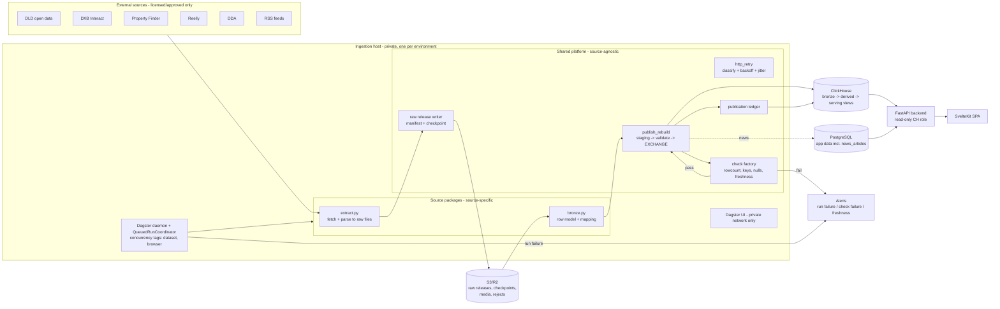

# Target Data Pipeline Architecture

> **PROPOSED TARGET STATE.** Nothing in this document exists yet unless marked *(exists)*. It
> describes where the data pipelines should end up after the phases in
> [MIGRATION_PLAN.md](../migration/MIGRATION_PLAN.md). The platform-level target (AWS UAE, ECS,
> RDS, ClickHouse Cloud, Cognito, observability) is defined in
> [production-readiness-2026-09-29.md](../../production-readiness-2026-09-29.md) and is assumed here,
> not redesigned.

## 1. Design principles

1. **Keep what works.** Holocron's source packages, immutable raw releases, manifests, checkpoints, `EXCHANGE TABLES` swaps and Dagster already form a sound skeleton *(exists)*. The target adds missing guarantees; it does not replace the skeleton.
2. **One orchestrator, one owner per table.** Every published dataset is produced by exactly one Dagster asset. No laptop, systemd or cron publication.
3. **Publish atomically, after validation.** Consumers see either the previous good version or the new validated version, never an intermediate state.
4. **Raw is the recovery path.** Any derived table can be rebuilt from R2/S3 raw releases by replay into staging.
5. **Smallest shared layer that removes duplication.** Shared: publication, checks, retry classification, run tags, ledger. Source-specific: fetching, parsing, row mapping.
6. **No new infrastructure in Phase 1.** No Kafka, Celery, SQS, dbt, second warehouse or Kubernetes. Dagster, ClickHouse, PostgreSQL and object storage are enough for ~150 users and ~20 datasets.

## 2. Architecture diagram



## 3. Component responsibilities

| Component | Responsibility | Owner / location |
|-----------|----------------|------------------|
| **Source package** | Fetch from one provider, write raw files, map raw rows to bronze rows, declare tables, business keys, publication mode, SLA and licence status | `holocron/holocron/sources/<source>/` *(exists; extended)* |
| **Raw release writer** | Upload files, write manifest, write checkpoints after manifest | `orchestration/factory.py::_run_raw_extractor` *(exists; source-name branches move to hooks)* |
| **Publisher** | Build staging, run blocking checks, atomically publish, record ledger row, clean staging | `platform/publish.py` *(new, wraps existing `replace_table_rows`)* |
| **Check factory** | Generate Dagster asset checks from table metadata | `orchestration/checks.py` *(new)* |
| **Retry helper** | Classify transient errors; exponential backoff with jitter; honour `Retry-After` | `platform/http_retry.py` *(new, ~40 lines)* |
| **Publication ledger** | One row per publication: source, table, manifest, dataset version, rows in/published/rejected, status, duration | `bronze_load_ledger` *(exists; extended columns; written on every publish)* |
| **Derived assets** | Silver, geography, serving facts; triggered by upstream publication | `holocron/holocron/{silver,assets}` *(exists)*, plus serving views moved from `backend/scripts/clickhouse/` |
| **Schema migrator** | Apply versioned ClickHouse DDL once per release with a privileged role | `platform/clickhouse_schema.py` *(exists; becomes a migrator)* |
| **Serving contract** | The explicit list of tables and columns the backend reads, verified on a fresh warehouse | `holocron/holocron/lib/sql/serving_contract.py` *(new)* + a CI test |
| **Backend** | Read-only consumer; freshness from the ledger; cache keys include dataset version | `backend/app/*/queries.py` *(exists; small changes)* |

## 4. Data flow (target)

```text
Dagster schedule / upstream-published automation
 ↓ raw asset  (source extract.py; http_retry; rate caps; checkpoints)       → S3 raw + manifest
 ↓ bronze asset (reads manifest BY KEY from S3; row model validation; rejects → S3)
 ↓ publish = ONE primitive, "rebuild staging then exchange", with a per-table keep rule:
     full_replace   : staging = new rows                                   → checks → EXCHANGE → ledger
     window_replace : staging = live rows OUTSIDE the refreshed window + new rows → checks → EXCHANGE → ledger
     key_replace    : staging = live rows whose business key is NOT in the batch + new rows → checks → EXCHANGE → ledger
     (ceiling: copies the table per publish; switch a table to monthly partitions + REPLACE PARTITION
      only if a measured publish exceeds ~10 min or ~50M rows)
 ↓ non-blocking asset checks (freshness, null ratios, anomalies) → alerts
 ↓ derived assets auto-materialise on upstream publication (silver, geo, facts)
 ↓ cache invalidation asset (Redis prefixes) after derived publication
 ↓ backend reads serving views (read-only role) → SPA
```

## 5. Shared infrastructure vs source-specific logic

| Shared (write once, in `platform/` or `orchestration/`) | Source-specific (in `sources/<source>/`) |
|------|------|
| Raw upload, manifest, checkpoint storage *(exists)* | How to page, authenticate, parse |
| Retry classification + backoff policy | Which endpoints; request shapes; rate caps values |
| Publication modes + staging + EXCHANGE + ledger | Row model (Pydantic) and bronze column mapping |
| Asset-check generation | Business key, SLA, row-floor values (as metadata) |
| Run tags and concurrency limits | Which tag values apply (e.g. `browser`) |
| Outbound URL safety for media *(exists, hardened)* | Allowed media hosts |
| Replay and dataset versions *(exists)* | — |
| Secrets retrieval from env *(exists via Settings)* | Which secret names the source needs |

Adding a new source requires, as today: `source.py`, `extract.py`, `bronze.py`, one registry
line, and DDL. The only additions are **metadata** in `source.py` (keys, mode, SLA, licence) and
a README licence section. Checks, publication, ledger and alerts come for free.

## 6. Contracts (interfaces)

### 6.1 `SourceSpec` (extended, backwards compatible)
```python
@dataclass(frozen=True, slots=True)
class BronzeTable:                       # exists: name, source_key
    name: str
    source_key: str | None = None        # business key column(s), comma-separated; now REQUIRED for published tables
    publish_mode: Literal["full_replace", "window_replace", "key_replace"] = "full_replace"   # new
    min_row_ratio: float | None = 0.9    # new: blocking floor vs previous publication (full_replace)
    freshness_column: str | None = None  # new: business date or scraped_at column
    freshness_sla_hours: int | None = None
    required_columns: tuple[str, ...] = ()

@dataclass(frozen=True, slots=True)
class SourceSpec:                        # existing fields unchanged
    ...
    production_approved: bool = False    # new: licence recorded; scheduling in prod refused otherwise
    resolve_config: Callable[[dict, ObjectStore], dict] | None = None   # new hook (replaces factory branches)
    after_manifest: Callable[[RawRelease, str, ObjectStore], None] | None = None   # new hook
    uses_state_store: bool = False       # new hook flag
    run_tags: Mapping[str, str] = field(default_factory=dict)   # e.g. {"resource": "browser"}
```
- **Responsibility:** declare everything the platform needs to run, check and publish a source.
- **Errors:** registry validation raises at import time (a bad spec fails CI, not production).
- **Lifecycle:** module import; immutable.
- **Testing:** `holocron/tests/test_sources.py`: every registered published table has `source_key`, and every scheduled source is `production_approved`.

### 6.2 Publisher (`platform/publish.py`)
```python
def publish_rebuild(*, clickhouse, table: BronzeTable, rows, column_names, run_id, manifest_key,
                    keep_where: str,            # SQL predicate over live rows to carry forward; "0" = full replace
                    validate: Callable[[StagingStats], None]) -> PublishResult
# thin helpers that only build keep_where:
def keep_outside_window(*, scope_sql: str, window_sql: str) -> str          # NOT (scope AND window)
def keep_other_keys(*, scope_sql: str, key_column: str, key_temp_table: str) -> str
```
The steps are:

1. `CREATE TABLE <t>_staging_<run> AS <t>`
2. `INSERT INTO staging SELECT * FROM <t> WHERE <keep_where>`
3. Insert new rows.
4. `validate(stats)`
5. `EXCHANGE TABLES`
6. Write the ledger row.
7. Drop staging.

This generalises the existing `ClickHouseClient.replace_table_rows` *(exists; used by DDA, PF
locations, DXBI heatmap)*, which is the case `keep_where="0"`. Evidence for choosing it over
delete+insert (AGENTS Rule 5): it is atomic, already the more-used pattern (DDA, silver, geography,
Pulse, `sync_dld`, the DXBI loaders), and needs no table-engine change and no `FINAL` in serving views.

- **Inputs:** mapped rows (already validated per row), table metadata, provenance.
- **Outputs:** `PublishResult(table, rows_published, previous_rows, staging_table, duration_s)`. One ledger row is written.
- **Errors:** `PublicationRejected(reason)` when blocking validation fails. Staging is dropped and the live table is untouched. ClickHouse errors propagate so Dagster retries the step.
- **Dependencies:** `ClickHouseClient` *(exists)*.
- **Lifecycle:** per bronze materialisation. Staging names include `run_id` so parallel datasets don't collide.
- **Testing:** real-ClickHouse integration tests (standards S4.1): atomic visibility, crash before exchange, floor rejection, idempotent re-run.

### 6.3 Check factory (`orchestration/checks.py`)
```python
def build_checks_for_source(source: SourceSpec) -> list[AssetChecksDefinition]
```
- Generates per table: `row_floor` (blocking for full-replace, evaluated in the publisher), `unique_business_key`, `required_non_default`, `freshness`, and `no_capped_run` (fails if raw manifest config contains `max_*` caps and the table is full-replace).
- **Outputs:** Dagster `AssetCheckResult` with numeric metadata (counts, ratios).
- **Testing:** one failing fixture per check type.

### 6.4 Retry helper (`platform/http_retry.py`)
```python
def is_retryable(exc: Exception) -> bool          # timeouts, transport, 5xx, 408, 429
def backoff_seconds(attempt: int, *, base: float, cap: float, retry_after: float | None) -> float
def retry_call(fn, *, attempts: int, base: float = 1.0, cap: float = 60.0, sleep=time.sleep)
```
- Source clients keep their own request code and wrap the call. No framework and no session management.
- **Testing:** pure unit tests (injected `sleep`).

### 6.5 Publication ledger (extended `bronze_load_ledger`)
Columns added: `run_id` *(exists)*, `rows_in`, `rows_rejected`, `previous_rows`, `publish_mode`,
`duration_ms`, `dagster_run_id`. Written by the publisher on success **and** rejection.
**Consumers:** freshness checks, the backend `refreshed_at` endpoint, and the operator dashboard.

### 6.6 Serving contract (`holocron/holocron/lib/sql/serving_contract.py`)
A Python mapping `{object_name: required_columns}` for every ClickHouse object the backend reads.
It is generated once from `backend/app/**/queries.py` and then maintained. A CI test applies the
schema to an empty ClickHouse and asserts the contract. The backend integration fixtures should
create tables from the Holocron schema instead of hand-written DDL.

## 7. Storage (target)

| Layer | Tables | Publication mode | Notes |
|-------|--------|------------------|-------|
| Raw | S3 `raw/…` | immutable | Lifecycle policy; replay source |
| Bronze (facts) | `dld_od_transactions_bronze`, `dld_od_rents_bronze`, `dld_od_valuations_bronze` | `window_replace` on the business date column (as transactions/rents already do semantically) | Removes delete mutations; no engine change |
| Bronze (inventories) | `dld_od_{projects,developers,buildings,units,lands,brokers}_bronze` | `key_replace` on the measured business key for daily incrementals + weekly `full_replace` snapshot (self-healing) | Fixes F03 |
| Bronze (snapshots) | `pf_locations_bronze`, `dda_*`, DXBI heatmap | `full_replace` with row floor *(exists minus floor)* | Floor protects against partial runs |
| Bronze (listings/catalogue) | `pf_listings_bronze`, `reelly_*_bronze` | `key_replace` + `last_seen_at`; withdrawal = not seen in the last complete crawl | Fixes stale inventory |
| Evidence | `dxbi_rental_*`, `dxbi_sales_unit_events`, matches | existing ReplacingMergeTree + staging/EXCHANGE loaders, moved into Dagster | Keep their validation; add ledger |
| Derived | `silver_*`, `geo_*`, `offplan_*`, facts | `full_replace` with blocking floor | Auto-materialised on upstream publish |
| Manual state | `*_overrides` | never replaced by pipelines | Backed up separately |
| Serving | `ch_*` views | DDL via migrator | Owned by Holocron; the backend only reads |
| App DB | `news_articles` | Alembic-owned schema; pipeline uses `INSERT … ON CONFLICT (article_key)` | Unique index added by Alembic |

## 8. Validation

1. **Row level** (bronze mapping): required keys present, types parse. Otherwise the row goes to rejects (counted).
2. **Table level, blocking** (publisher): row floor, unique business key, no capped run.
3. **Table level, non-blocking** (asset checks): null or default ratios, freshness, distribution anomalies (e.g. daily transaction count outside ±3σ of the trailing 30 days). Add these only after baseline data exists.

## 9. Observability

- Dagster run and asset-check status is the operational UI (private).
- A run-failure sensor and check-failure sensor send to a webhook (channel: *requires human confirmation*).
- The ledger gives freshness. The backend exposes `GET /api/v1/data/freshness` (per dataset `refreshed_at` and SLA state) so the UI can show stale-data warnings (reference §2).
- JSON logs to stdout are collected by the host agent (CloudWatch in the AWS target).

## 10. Error handling

| Failure | Handling |
|---------|----------|
| Transient network | `retry_call` inside the extractor, then Dagster `RetryPolicy` on the raw asset |
| Provider auth expiry | Fail fast with a distinct error message and alert; no retry storm |
| Malformed row | Rejected and counted; publish continues unless the reject ratio exceeds a threshold |
| Structural change (envelope) | Fail the run |
| Blocking check fails | `PublicationRejected`: live data untouched, alert, raw kept for replay |
| ClickHouse down | Bronze step fails and retries; raw already durable; resume by re-materialising bronze from the manifest key |
| Crash mid-run | Checkpoint resume (raw); staging dropped on next attempt (publish) |
| Duplicate execution | Concurrency tag `dataset=<name>: 1`; idempotent publication modes |

## 11. Security

- The ingestion host is private. The Dagster UI is reachable only via SSM, VPN or tunnel.
- Separate ClickHouse identities: `holocron_writer` (INSERT, staging CREATE/DROP, EXCHANGE on owned tables), `holocron_migrator` (DDL), `api_reader` (SELECT on serving objects).
- The PostgreSQL role for news publication has `INSERT/UPDATE` on `news_articles` only.
- Provider credentials exist only on the ingestion host, from the secret manager. They are never in run config.
- Outbound media fetch resolves DNS and rejects private ranges post-resolution.
- Sources not `production_approved` cannot be scheduled in production.

## 12. Configuration

Unchanged layering (code defaults → job config mappings → `Settings` env → secrets). Additions:

- `HOLOCRON_ENVIRONMENT` (`local|staging|production`) gates `production_approved` enforcement and schedule defaults. Production schedules default to `RUNNING` only for approved datasets, which removes today's ambiguity of "defined but STOPPED".
- Host-specific paths are removed from repo units. Paths come from env.

## 13. Testing (target)

- Unit (fakes) stays as is (469 tests).
- A new `holocron/tests/integration/` suite runs against a ClickHouse 24.8 service container in CI: publisher modes, per-source idempotency and overlap, the serving contract on a fresh warehouse, and replay into staging.
- A pipeline test per source: recorded raw fixture → `dagster.materialize([raw, bronze, checks])`.
- Backend ClickHouse integration fixtures are built from the Holocron schema (single contract).

## 14. What is intentionally not in the target

- A generic "source adapter / fetcher / parser" class hierarchy. Sources differ too much (browser vs API vs files). The shared contract is the *output* (raw release + mapped rows + table metadata), not the fetch mechanics.
- A general HTTP client wrapper. Only error classification and backoff are shared.
- dbt. Silver and geography SQL remain small and Dagster-native. Revisit if derived models grow past ~20.
- Streaming or CDC. Sources are daily or weekly batch. News at 15 min is well within batch.
