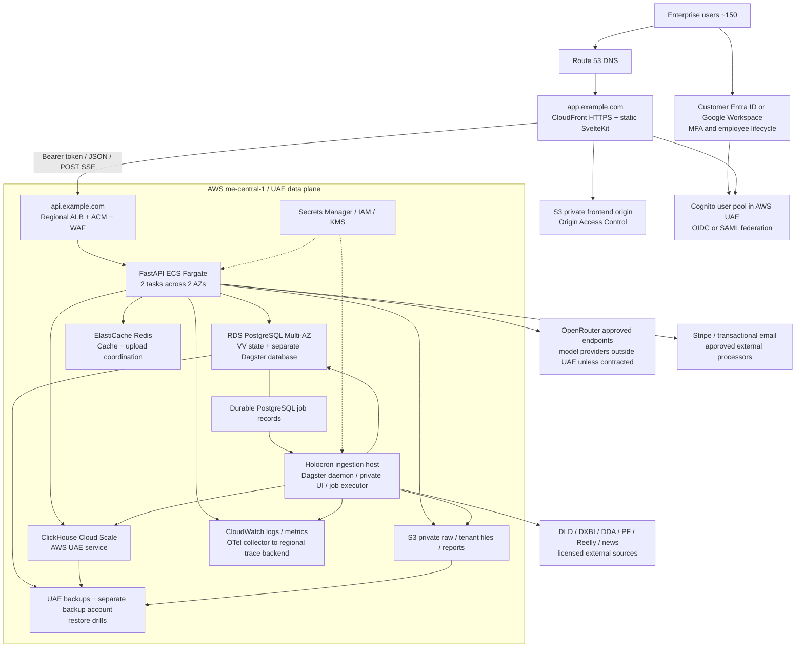

# VV production-readiness and launch architecture

**Study date: 29 September 2026. Scope: the supplied `/home/maan3/vv/VV` source snapshot. Status: architecture recommendation; no deployment or application changes performed.**

## 1. Decision

**Launch the first enterprise on AWS Middle East (UAE), `me-central-1`, with ECS/Fargate, RDS PostgreSQL, ClickHouse Cloud Scale in the same region, S3, Cognito federated to the customer's identity provider, and a separate Holocron ingestion host.** Serve the SvelteKit application as static assets through CloudFront. Retain a small managed Redis deployment because the code uses Redis for upload coordination as well as caching.

This recommendation prioritizes regional data placement, managed database recovery, enterprise identity, and continuity with the existing Python/PostgreSQL/ClickHouse application. AWS lists three UAE availability zones; RDS and Cognito have UAE endpoints; ClickHouse's current region table explicitly lists AWS UAE as **Public**, whereas Azure UAE North is **Private**. This materially improves the case for AWS over a cross-region analytics deployment. [AWS regions](https://docs.aws.amazon.com/global-infrastructure/latest/regions/aws-regions.html), [RDS regions](https://docs.aws.amazon.com/AmazonRDS/latest/UserGuide/Concepts.RegionsAndAvailabilityZones.html), [Cognito endpoints](https://docs.aws.amazon.com/general/latest/gr/cognito.html), [ClickHouse regions](https://clickhouse.com/docs/products/cloud/reference/supported-regions).

**Do not launch this snapshot unchanged.** The main blockers are migration reproducibility, incomplete tenant scoping of conversations, inconsistent AI privacy and spend controls, non-durable HTTP imports, incomplete streaming failure handling, and an untested data publication/recovery process. These are application and operational gaps; buying managed infrastructure does not close them.

The recommended operating budget is approximately **$2,900/month before contingency**, including a small staging environment and an illustrative AI allowance. Authorize **$3,200–$4,000/month** initially, **plus separately contracted external data licenses and any enterprise vendor commitments**. A leaner configuration is approximately **$1,400/month including modest staging**, with lower capacity. These are budget models, not quotes; ClickHouse UAE pricing and data-provider contracts remain procurement gates. Section 13 gives the complete arithmetic and assumptions.

Deliberately postpone Kubernetes, microservice decomposition, Kafka, service mesh, a second warehouse, a vector database, self-hosted models/GPUs, a general-purpose AI gateway, active-active regions, and a second evaluation SaaS. Keep the existing domain-oriented backend and Dagster. Introduce only one small durable import/report job mechanism when moving the existing large HTTP workloads out of requests.

## 2. Evidence, boundaries, and workload assumptions

Labels throughout this document:

- **R — Repository fact:** directly observed in source/configuration. It does not establish what a running server currently has installed.
- **D — Documentation fact:** current public vendor documentation or pricing, linked near the claim.
- **A — Assumption:** a planning input that must be measured or agreed.
- **P — Proposal:** an engineering decision to implement after this study.

**Inspection limits:** this directory has no `.git`, so there is no verifiable commit SHA, branch, or clean-worktree claim. The specifically requested `backend/ARCHITECTURE.md` and `backend/EVALUATION.md` are absent, including the filename search outside dependency/generated directories. `holocron/ARCHITECTURE.md` exists and was reviewed. No LangSmith integration or dedicated evaluation runner was found in the searched application, scripts, tests, and dependency declarations. This is not a claim about unprovided branches or external services.

The review traced browser auth/API requests, backend middleware and route dependencies, PostgreSQL models and all 11 migration files structurally, ClickHouse clients and representative analytics/CRM/agent queries, the 53 table declarations in the central warehouse schema, compatibility/fact builders, 18 registered ingestion source units, Dagster schedules, systemd/launchd jobs, object storage, billing, telemetry, and the visible GitHub deployment workflow. Immediate service callers and existing tests were inspected for the identified risks. This is a source architecture/security assessment, not an executed penetration test or exhaustive proof that every endpoint is secure.

No secrets files were read, no live databases were queried, no provider APIs were called with customer credentials, no migrations/tests/bootstrap/deploy commands were run. Public documentation and public AWS price catalogs were fetched. `just --list` and read-only source/AST checks were run. The sandbox launcher lacked `bwrap`; source reads used the approved host shell. No approval rejection blocked the study.

**A — Capacity envelope for Phase 1:** 150 provisioned users; 30–50 simultaneous active browser sessions during peaks; 10–20 simultaneous AI turns; roughly 0.5–2 million HTTP requests/month; burst tests at 20–30 HTTP requests/second; 5,000–30,000 AI turns/month; 10–30 concurrent warehouse queries during bursts. UI fan-out means one page can issue several analytical queries. These are test targets, not measurements inferred from user count.

**A — Initial storage budgets:** PostgreSQL 100 GB provisioned, with actual application data likely much smaller initially; ClickHouse 100–500 GB compressed; raw/media object storage 1–2 TB. No trustworthy live row counts, compressed sizes, growth rates, query latency percentiles, provider quotas, or user activity measurements were discoverable. A Bayut README's approximate 245,000-row discussion is not a warehouse inventory and must not drive sizing.

**P — Service objectives:** agree a 99.9% monthly application availability target; p95 ordinary CRUD under 1 second, common analytics under 3 seconds warm, heavier interactive research under 10 seconds; AI first useful event under 5 seconds where provider latency permits. Set chat execution deadlines initially to 5 minutes. These are acceptance targets, not promises supported by current tests. Define market freshness separately: daily source updates within 36 hours, news within 60 minutes, and visible stale-data warnings.

## 3. What actually runs today

### Frontend

**R:** Svelte 5, SvelteKit 2, Vite 7, TypeScript, Bun, Tailwind 4, TanStack Svelte Query, MapLibre, Chart.js, Stripe JS, Supabase Auth JS, and PostHog. `bun run build` invokes Vite. The root layout explicitly has `ssr = false` and `prerender = false`; `hooks.server.ts` simply resolves requests. The active adapter is `adapter-auto`, despite deployment documentation referring to Cloudflare Pages. No substantive server route/action requirement was found.

The browser calls typed wrappers in `frontend/src/lib/api`, with query definitions in `frontend/src/lib/queries`. `PUBLIC_API_BASE_URL` is prepended to paths such as `/api/v1/chat/...`; do not put `/api/v1` in the base twice. `PUBLIC_AUTH_BASE_URL` points directly to GoTrue. Optional public PostHog host/key are consumed in the root layout. Public values currently use `$env/dynamic/public`; changing to static hosting therefore requires an explicit build-time public configuration strategy. Vite's `/api` and `/auth-proxy` proxies are development behavior, not production reverse proxies.

Authentication persists a Supabase session under the `authentication` storage key. API requests attach bearer access tokens and also set `credentials: include`. POST SSE uses `fetch`/`ReadableStream`, not native EventSource. Route guards run in the browser; backend guards must remain authoritative. Some UI preferences, filters, and workflow state live in localStorage and are not centrally backed up.

Evidence: [frontend package](/home/maan3/vv/VV/frontend/package.json), [adapter](/home/maan3/vv/VV/frontend/svelte.config.js), [layout](/home/maan3/vv/VV/frontend/src/routes/+layout.ts:10), [API client](/home/maan3/vv/VV/frontend/src/lib/api/client.ts), [auth client](/home/maan3/vv/VV/frontend/src/lib/api/auth.ts).

### Backend and state

**R:** Python 3.13+, FastAPI, SQLModel/SQLAlchemy async sessions with asyncpg, Alembic, clickhouse-connect, Pydantic AI, aioboto3, Redis, Stripe, Logfire, and optional Honeybadger. The image runs Gunicorn with **two Uvicorn workers**, bound to port 8000. It uses `uv sync --locked`, runs as root, includes the backend tree, and has no explicit production drain/stream timeout configuration. A WorkOS dependency exists, but no functioning WorkOS auth integration was found.

The backend is a modular monolith, not a collection of microservices. Ordinary requests combine GoTrue verification, membership/subscription lookup in PostgreSQL, cached analytics in Redis, and ClickHouse queries. CPU-heavy exceptions include spreadsheet import/export, feasibility calculations, large result materialization, and data transformations. Streaming mostly waits on network I/O. Pandas/openpyxl and in-memory `BytesIO` exports can amplify RAM use considerably; there is no measured memory profile.

Durable application state is in PostgreSQL and object storage. Redis holds reconstructable cache entries **and non-cache upload session state**. In-flight AI execution, local logs, some singleton clients/caches, and request buffers are process-local. There is no durable general-purpose backend worker framework in the HTTP app. Some `asyncio.create_task` calls parallelize awaited listing queries; that is not a job queue.

The PostgreSQL pool permits 5 pooled + 10 overflow connections **per worker**, so the existing two-worker container can reach 30 database connections. ClickHouse uses a process-global async client, 10-second connection timeout, 300-second receive timeout, two query retries, and compression. Its results are often fully materialized. Lifespan cleanup closes PostgreSQL and ClickHouse, but comprehensive cancellation/client cleanup is not evident.

Evidence: [startup](/home/maan3/vv/VV/backend/app/main.py), [image](/home/maan3/vv/VV/backend/Dockerfile), [dependencies](/home/maan3/vv/VV/backend/pyproject.toml), [PostgreSQL client](/home/maan3/vv/VV/backend/app/postgres/client.py), [ClickHouse client](/home/maan3/vv/VV/backend/app/clickhouse/client.py).

### Actual request paths

| Path | Execution and durable result |
|---|---|
| Login | Browser → GoTrue → token/session; API independently calls GoTrue `get_user(jwt)` on authenticated requests. Auth availability and latency therefore affect every API request. |
| Analytics/radar | Bearer verification → membership/subscription → optional Redis cache → ClickHouse templates/joins/facts → JSON to browser. |
| General chat | Membership/subscription + daily quota check → conversation ownership lookup → save user message → load history → OpenRouter/Pydantic AI + predefined ClickHouse tools → SSE → record usage and save assistant message at successful completion. |
| Feasibility | Plot/market research + deterministic calculations and model-assisted study generation; chat sends current plot/study/assumptions to the model. Saved studies are filtered by user and organization. AI mutation tools stage workbook suggestions for user approval. |
| CRM | Organization-scoped PostgreSQL imports/contacts/claims/notes + shared ClickHouse evidence; optional direct HTTP OpenRouter calls for header mapping and redacted enquiry extraction. Large imports remain attached to the HTTP request even when parsing uses `asyncio.to_thread`. |
| Exports | ClickHouse query → Python rows/workbook in memory → response stream. Filter exports cap at 50,000 rows; explicit-ID branches do not use that filter limit. A StreamingResponse does not make generation incremental. |
| ETL upload | Shared service API key → read chunk → object storage → Redis set/expiry → write completion metadata. The endpoint says assembly belongs to an ETL node; an operational end-to-end assembler must be identified and tested before enabling this ingress. |
| Billing | Stripe API/Checkout + signature-verified webhook → synchronize subscription state in PostgreSQL → subscription guard controls access. |

Evidence: [chat routing](/home/maan3/vv/VV/backend/app/chat/router.py), [chat execution](/home/maan3/vv/VV/backend/app/chat/service.py:1885), [feasibility routing](/home/maan3/vv/VV/backend/app/feasibility/router.py), [CRM import](/home/maan3/vv/VV/backend/app/crm/import_service.py:2193), [exports](/home/maan3/vv/VV/backend/app/transaction/service.py), [uploads](/home/maan3/vv/VV/backend/app/upload/service.py), [Stripe webhook](/home/maan3/vv/VV/backend/app/billing/webhooks.py).

### Configuration and deployment contradictions

**R:** Pydantic settings load `.env.dev`/`../.env.dev`; process environment overrides these. Local guidance says host processes should use `.env.dev`, but `just dev-*` currently sources `.env`. Guidance describes Compose as local only, while `docker-compose.yml`, `just deploy`, and the GitHub workflow explicitly deploy to a `ph-box` with host PostgreSQL/ClickHouse and containerized API/GoTrue/Redis. Documentation says `check-all` runs lint; the actual recipe formats and tests, and the listed standalone lint recipes are absent.

**P:** Treat executable source as the description of current behavior. Replace the old deployment path with one reviewed infrastructure/pipeline definition when implementation starts. Update the stale guidance then; do not blend `.env`, `.env.dev`, Cloudflare assumptions, and ph-box commands into production automation.

## 4. Recommended architecture and networking



The diagram is not a serial database chain: PostgreSQL, ClickHouse, models, and storage are parallel backend dependencies. Provider ingestion runs independently of user HTTP traffic. ClickHouse Cloud is in its vendor-managed account, not automatically inside VV's VPC; same region is not the same security boundary.

**P — Network layout:** separate staging and production AWS accounts; a production VPC spanning two availability zones; public subnets for the ALB and NAT gateways; private application and database subnets. API tasks receive traffic only from the ALB security group. RDS/Redis accept only approved API/worker security groups. Use an S3 gateway endpoint, per-task IAM roles, restrictive bucket policies, and encrypted EBS/RDS/S3. Use ClickHouse PrivateLink when the chosen UAE service supports it; otherwise TLS plus fixed NAT egress IP allowlisting is a documented initial fallback. Never expose PostgreSQL, Redis, ClickHouse administrative interfaces, or Dagster to the public internet.

Use `app.example.com` for frontend, `api.example.com` for regional API, and a Cognito/custom login domain for authentication. CloudFront carries public application assets; the browser connects directly to the regional API for SSE. Do not put private API responses in a CDN cache. Set API CORS to exact frontend/staging origins in their respective environments, never wildcard credentials. Use ACM regional certificates for ALB, and the required CloudFront certificate region for the distribution; keep authentication callback URLs explicit. Global DNS/CDN services still process some metadata outside the UAE.

Set HSTS after validating all subdomains, CSP appropriate to MapLibre and approved model-output rendering, `frame-ancestors`, `nosniff`, and a restrictive referrer policy. Route unknown application paths to the SPA shell, but do not rewrite missing JavaScript/image requests into HTML. Apply regional WAF limits to login-facing API routes, uploads, exports, and AI endpoints, with separate limits for webhook/infrastructure traffic.

**P — Private access for operators:** AWS IAM Identity Center for VV staff, MFA, least-privilege roles, Systems Manager access to the ingestion host, no routine inbound SSH. This is separate from Cognito, which authenticates customer application users.

## 5. Alternatives considered

| Option | Fit for VV and current regional facts | Pricing/limits and decision |
|---|---|---|
| **AWS UAE: Fargate + RDS + Cognito + S3 + ClickHouse Cloud UAE** | Co-locates primary application/analytics data. Existing containers and S3-compatible code fit. Managed SSO requires replacing GoTrue-specific identity plumbing. | Exact UAE compute/database sample rates in §13. ALB supports long streams when configured. **Recommended.** |
| **GCP Doha: Cloud Run + Cloud SQL HA + GCS + Identity Platform** | Cloud Run is technically suitable. Google's current region list has Doha/Dammam, not a UAE compute region; a Dubai network edge is not a Dubai database region. ClickHouse's current public GCP region list does not include Doha/Dammam, requiring a cross-region or cross-cloud choice. | Cloud Run reference active rates include $0.000024/vCPU-second and $0.0000025/GiB-second, with region/billing-mode differences. Cloud SQL reference Enterprise compute starts at $0.0413/vCPU-hour and $0.007/GiB-hour before HA/storage. Identity Platform federation is $0.015/MAU after 50. Strong alternative if non-UAE storage is explicitly accepted; not the regional default. |
| **Azure UAE North: Container Apps/App Service + PostgreSQL Flexible Server + Blob + Entra** | Credible UAE alternative, especially if procurement mandates Microsoft. Microsoft documents Container Apps functionality in UAE North and PostgreSQL regional/HA options. ClickHouse UAE North is a private region requiring Enterprise onboarding; AWS ClickHouse hybrid is another option. | Azure regional SKU quote, capacity, ingress behavior, and ClickHouse Enterprise minimum must be checked. Standard Container Apps HTTP ingress documents 240-second timeout; validate/configure the selected ingress tier for VV streams. External ID core pricing has a first-50,000-MAU free tier, but workforce licenses, federation features and region guarantees need separate review. Second choice for a Microsoft-mandated customer. |
| **Managed Supabase + external FastAPI + ClickHouse** | Lowest identity rewrite risk because GoTrue/Auth JS already exists. Supabase PostgreSQL/Auth/Storage do not replace the backend or ClickHouse. The current public specific-region list does not offer UAE. | Pro starts at $25/month; compute, HA/service commitments, PITR and storage are separate considerations. SSO MAU overage is $0.015 after 50 included on Pro; 7-day PITR is approximately $100/month extra. Not a complete $25 production stack. Use if approved non-UAE data placement and migration speed outweigh regional consolidation. |
| **Firebase Hosting/Auth + GCP backend** | Hosting and Identity Platform can be useful independently. Firestore is not a replacement for this SQLModel/Alembic application or ClickHouse analytics. | Generic OIDC/SAML requires Firebase Authentication with Identity Platform. Authentication tenant features do not implement VV data authorization. No reason to rewrite the data model into Firebase. |
| **Keep self-hosted GoTrue on AWS UAE** | Preserves current API/frontend contracts and regional auth database. Requires VV to operate auth HA, signing keys, email, upgrades and SSO configuration. | Realistic fallback if Cognito migration is not accepted, but not the preferred long-term enterprise operation. Require a working SSO/MFA/offboarding proof before considering it launch-ready. |
| **Keep ph-box/self-host PostgreSQL/ClickHouse** | Fewest immediate changes, highest operational concentration and unverified recovery. | Suitable for development, staging, or a controlled evaluation. Not recommended as the sole business-critical customer environment. |

Sources: [Cloud Run locations](https://cloud.google.com/run/docs/locations), [Google locations](https://cloud.google.com/about/locations), [Cloud Run pricing](https://cloud.google.com/run/pricing), [Cloud SQL pricing](https://cloud.google.com/sql/pricing), [Identity Platform pricing](https://cloud.google.com/identity-platform/pricing), [Firebase OIDC](https://firebase.google.com/docs/auth/web/openid-connect), [Azure Container Apps regions](https://learn.microsoft.com/en-us/azure/container-apps/express-overview), [Azure ingress](https://learn.microsoft.com/en-us/azure/container-apps/ingress-overview), [Azure PostgreSQL](https://learn.microsoft.com/en-us/azure/postgresql/overview), [Entra External ID pricing](https://learn.microsoft.com/en-us/entra/external-id/external-identities-pricing), [Supabase regions](https://supabase.com/docs/guides/platform/regions), [Supabase pricing](https://supabase.com/pricing), [Supabase SSO usage](https://supabase.com/docs/guides/platform/manage-your-usage/monthly-active-users-sso), [Supabase PITR](https://supabase.com/docs/guides/platform/manage-your-usage/point-in-time-recovery).

**D:** AWS now says App Runner is closed to new customers and recommends ECS Express Mode as its migration path. Do not choose App Runner for this new launch. ECS Express Mode may simplify provisioning, but standard ECS infrastructure-as-code is the proposed baseline so networking, stream draining and database connection budgets remain explicit. [AWS availability change](https://docs.aws.amazon.com/apprunner/latest/dg/apprunner-availability-change.html).

**P:** This is a deliberate hybrid only where it adds value: AWS infrastructure + managed ClickHouse + approved AI providers + the customer's IdP. Adding separate Supabase, Firebase, R2, Logfire and LangSmith accounts to the primary path would increase identity, residency and incident boundaries without a demonstrated Phase 1 benefit.

## 6. Enterprise identity, permissions, and tenancy

**P — Phase 1:** use the customer's existing identity provider from the start: Microsoft Entra ID for a Microsoft enterprise, Google Workspace for a Google enterprise. Broker the approved organization connection through a Cognito user pool in UAE using OIDC where supported and suitable, or SAML 2.0 where customer IT standardizes on it. The user's email address does not tell us which provider the customer uses; this is an onboarding input, not an architectural ambiguity requiring two identity stacks.

```text
Employee assigned to VV in company identity directory
 → company MFA / conditional access
 → Cognito verifies the configured OIDC issuer or SAML assertion
 → VV validates the access token and maps immutable issuer/subject to an internal user
 → server resolves active organization membership and entitlements
 → owner/member permissions plus resource ownership checks
 → ordinary API services and the same authorized services used by AI tools
```

| Method | Assessment for the first enterprise |
|---|---|
| Email/password | Supported today, but adds passwords and offboarding obligations to VV. Restrict to monitored break-glass accounts with MFA if necessary. |
| Magic link / email OTP | Useful for invitations and limited fallback. Mailbox control is not proof of current employment or authorization. Do not let a magic-link account bypass an enterprise's SSO policy. |
| Google Workspace | Good when it is the customer's managed directory. Verify approved issuer, organization/domain policy and app assignment; generic Google login alone is insufficient. |
| Entra ID | Preferred for a Microsoft customer; customer IT owns app assignment, MFA and employee lifecycle. VV still checks membership on every request. |
| OIDC | Use authorization code + PKCE, exact redirect URI, state and nonce. Validate signature, issuer, expiration and appropriate token audience/client binding; reject ID tokens as API bearer credentials where access tokens are expected. |
| SAML SSO | Support via the identity broker; bind each trusted connection to an organization, validate signing keys, audience and replay protections through the broker. Certificate rollover becomes a monitored operational task. |
| Domain allowlist | Defense in depth for enrollment, never the tenant selector or sole authorization check. A caller-supplied domain or unverified email must not create membership. |

**R — Existing tenant foundation:** `organizations`, `organization_memberships`, invitations, subscription records, and `AuthContext` exist. Membership is intentionally limited to one organization per user by a unique constraint; roles are `owner` and `member`, with a separate global admin flag in GoTrue app metadata. Most business routes require an active subscription. CRM resources are organization scoped; saved feasibility studies require both user and organization. Invitations check that the authenticated email matches. This is useful groundwork, but there is no general PostgreSQL RLS policy layer in the visible migrations.

**R — Tenant gap:** conversations contain `organization_id` in the model and at creation, but list/get/update/delete ownership checks filter by `user_id`, and the stream's `organization_id` is not enforced. A user who moves to another organization can retain access to prior-organization conversations. This is not evidence that any user can read any other user's chat; it is a specific missing organization boundary. The baseline creates conversations without `organization_id`, and no later visible migration adds it. A fresh migration-only database is therefore inconsistent with the model. Evidence: [models](/home/maan3/vv/VV/backend/app/chat/models.py:12), [ownership queries](/home/maan3/vv/VV/backend/app/chat/service.py:58), [baseline](/home/maan3/vv/VV/backend/migrations/versions/8395bd1f2518_baseline_schema.py:30).

**P — Required identity migration, not an environment switch:** replace frontend AuthClient flows and backend GoTrue verification/admin/profile APIs; create a local user/identity mapping with stable internal IDs; move app-owned admin status and quota policy into protected PostgreSQL records; preserve or explicitly migrate every user reference in memberships, chats, studies, CRM and usage. Revoke old sessions at cutover. Disable public signup/self-service organization creation for the enterprise launch. Keep invitation and membership operations server-authorized. Do not auto-link accounts solely by matching email, especially privileged accounts. For a first customer with no production data, start with a clean customer user population while retaining only approved legacy data.

Store identity-provider connection → organization mapping server-side. Keep one organization per user for Phase 1 unless a real support/consultant requirement demands otherwise. Enforce `(organization_id, resource_id)` checks in shared services, including background jobs and AI. Add explicit membership suspension, revoke refresh sessions, and reject disabled membership immediately; directory offboarding alone may not invalidate an already-issued VV access token. Use short access-token lifetimes and test revocation behavior. Before Phase 2, automate membership provisioning/deprovisioning through an agreed directory/SCIM integration if required; do not assume Cognito itself provides a turnkey SCIM lifecycle.

**P — Permission model:** retain owner/member initially, with a documented permission matrix. Owners administer seats and settings; ordinary members access shared market data and approved tenant CRM; private studies/chats additionally require ownership. Separate platform super-admin from enterprise owner. Export, contact-data access, AI use and billing administration should be explicit capabilities if the first customer's policy requires differentiated access. Tenant isolation tests need two organizations, two users in the same organization, removed users, moved users, expired subscriptions and forged organization/resource IDs.

Use a migration/runtime-role separation. RLS can add defense in depth on tenant tables, but it requires transaction-local tenant context, a non-bypass role, worker support and tests. Do not claim RLS is active just because PostgreSQL or Supabase supports it. Server-side tenant predicates and negative tests are mandatory at launch; adopt RLS before broad shared multi-tenant rollout where feasible.

## 7. Data architecture and recovery

**P: PostgreSQL + ClickHouse + object storage is the complete Phase 1 data stack. No additional warehouse is needed.** ClickHouse already performs the warehouse/analytical serving role. S3 stores replayable raw releases and large files; PostgreSQL stores transactional, user-specific and tenant-specific state. BigQuery, Redshift, Snowflake or Firestore would add another copy and reconciliation path without solving an identified workload problem.

| Data | System | Why | Read pattern | Write pattern | Backup/recovery proposal |
|---|---|---|---|---|---|
| Credentials, identity-provider links, auth sessions | Cognito; internal identity map in PostgreSQL | Managed authentication; stable VV user identity | Login, token checks, identity lookup | Directory federation, admin lifecycle | Identity configuration as code; protected user-map backup; tested re-enrollment and session revocation runbook, not an assumed password export |
| Organizations, memberships, roles, invitations | PostgreSQL | Transactional constraints and server authorization | Every protected operation | Low-volume admin/invite changes | RDS PITR + snapshots |
| Permissions, dataset entitlements, AI policy | PostgreSQL | Explicit organization policy | Per request/tool/job | Audited admin changes | RDS PITR |
| Conversations and AI messages/artifacts | PostgreSQL | Ownership, history and transactional persistence | Latest user/org conversations; paged messages | Each turn and execution status | RDS PITR; policy-driven retention/deletion |
| Saved feasibility studies and report metadata | PostgreSQL | Versioned assumptions/workbook state and ownership | User/org lookup | Save/version/approval | RDS PITR |
| CRM contacts, claims, inbound leads, notes, assignments | PostgreSQL | Private enterprise data with relational consistency | Organization-scoped lookup/search/join | Imports and user edits | RDS PITR; deletion and legal-hold rules |
| Preferences/application state | PostgreSQL for shared/durable state; browser for cosmetic preferences | Avoid treating localStorage as enterprise records | Per user/session | Occasional updates | Server state backed up; local-only settings can reset |
| Properties/buildings/units/developers | ClickHouse | Broad read-mostly market reference joins | Filter/search/aggregation | Scheduled source refresh | Managed backups + immutable source replay |
| Sales transactions | ClickHouse | Date/location/project analytical scans | Trends, medians, comparables, exports | Batch lookback/incremental ingestion | Backups + versioned raw files/manifests |
| Rental contracts and DXBI rental/sales evidence | ClickHouse, classified by fields/license | Analytics, evidence matching and coverage | Date/unit/property joins, `FINAL`, latest evidence | Incremental/repaired/backfilled datasets | Backups + replay and reconciliation manifests |
| Listings | ClickHouse; media in S3 only when licensed | Current inventory with source lineage | Search + detail + AI artifacts | Daily deltas/details/media | Backups + raw releases; freshness and withdrawal handling |
| Projects, supply/delivery, Reelly documents/availability | ClickHouse + S3 documents | Analytical/project joins; large source documents | Project panels, supply, comparables | Catalog/availability deltas | Backups + raw/doc replay |
| GIS/plot geometry and geography/entity mappings | ClickHouse | Existing plot and hierarchy query model | Plot lookup, geospatial overlays, entity links | Weekly snapshots and derived refreshes | Backups; protect manual overrides separately |
| News | Raw/S3, curated feed records in PostgreSQL | Pipeline publishes frontend-ready news | Recent feed pagination | 15-minute polling/publication | PITR + raw manifests, thumbnail inventory |
| Evaluation metadata | Proposed PostgreSQL run summary + private S3 fixtures/results | Reproducibility without introducing another platform | Release comparison | CI/nightly approved evaluations | S3 versions + database backup; synthetic/redacted content |
| Uploaded enterprise files | Private tenant-prefixed S3; metadata in PostgreSQL | Durable asynchronous processing, size/lifecycle controls | Authorized signed download/worker read | Presigned bounded upload and import | Versioning, lifecycle, recovery drills |
| Generated XLSX/CSV/PDF reports | Private S3 + PostgreSQL owner/job record | Avoid repeated in-memory generation; controlled expiry | Short-lived authorized download | Worker generation | Short retention unless saved as business record; regenerate when possible |
| Pipeline runs, checkpoints, load ledger | Dagster PostgreSQL + S3 manifests + ClickHouse ledger | Replays, asset lineage and crash recovery | Operations/reconciliation | Each chunk/release/publication | RDS PITR, S3 versioning; verify cross-store recovery consistency |
| Durable import/export job state | PostgreSQL | Reliable execution/retry without a separate broker | Worker claim + client status | Enqueue, lease, retry, finish | PITR; idempotent handlers reconcile interrupted jobs |
| Cache / chunk receipt sets | Managed Redis | Current runtime integration | Very frequent/TTL | Cache fills and chunk coordination | Cache disposable; reconstruct receipt state from S3 or durably record it before relying on recovery |
| Logs and operational metrics | CloudWatch UAE; archived audit events in protected S3 | Support and incident response | Search, dashboards, alerts | Structured events/counters | Retention/lifecycle; immutable audit archive where required |
| Traces/model diagnostics | Regional OTel destination by default; optional approved Logfire | Latency/error/cost attribution | Sampled debugging | Redacted spans, no default prompt bodies | Short retention; not a backup of business records |

**P — PostgreSQL:** RDS PostgreSQL 16 initially, matching local major version; `db.m6g.large` (2 vCPU/8 GiB) Multi-AZ and 100 GB gp3, with storage autoscaling cap/budget alarms. One instance can host separate VV and Dagster databases with different roles. This deliberately shares infrastructure in Phase 1; monitor pipeline contention and separate later. Runtime users must not own schema or have superuser privileges. Validate SSL certificate verification and connection renewal/failover with asyncpg.

Application access is mostly indexed user/org/resource reads and small writes; CRM imports can create large batches and owner-identity joins. Preserve existing indexes/uniqueness; inspect `EXPLAIN ANALYZE` for real tenant sizes before adding indexes. Add atomic usage upserts with unique user/org/day keys, appropriate foreign keys and composite tenant indexes where the tested queries require them. Migrations must be serial, separate from HTTP task startup, with compatibility across the old/new app versions.

**P — Recovery targets:** PostgreSQL RPO ≤5 minutes and tested restore-to-service RTO ≤2 hours for logical loss; use 35-day PITR and periodic protected snapshots. These are targets to validate, not guarantees for arbitrary failures. ClickHouse published data RPO ≤24 hours, with raw releases persisted before publication to replay more recent data; target restore/replay ≤4 hours after measuring the real dataset. Pipeline host recovery ≤4 hours; raw data must not depend on its disk. Object versioning helps deletion recovery but is not an independent backup; keep protected backup copies in a separate account.

Multi-AZ availability and a same-region backup do not solve a regional disaster. Begin with UAE regional recovery and a tested rebuild runbook. Decide explicitly whether a disaster copy may be outside UAE; Bahrain is outside UAE. If the contract requires both in-country disaster copies and independent regions, procure an approved second UAE location/provider and price it separately. Do not promise regional-disaster RTO without this decision and a rehearsal. [RDS automated backups](https://docs.aws.amazon.com/AmazonRDS/latest/UserGuide/USER_WorkingWithAutomatedBackups.html).

## 8. ClickHouse design based on VV's workload

**R — Schema and access:** the central Holocron SQL file declares 53 tables. These include DLD source tables, DDA GIS, PF listings, Reelly, DXBI event/candidate/match tables, silver projections, geography/entity links, manual overrides and a bronze load ledger. Tables use MergeTree or ReplacingMergeTree, including timestamp-versioned replacements. There are no `PARTITION BY` or `TTL` clauses in this central schema file; other runtime-generated structures and a live server could differ.

The backend still queries compatibility names such as `ch_transactions`, `ch_rent_contracts`, `ch_projects`, `ch_units`, `ch_project_fact` and `ch_area_fact`. The compatibility-view script maps sales/rent views to **bronze** tables, even though silver datasets also exist. CRM queries additionally use DXBI event/candidate/match tables with `FINAL`, geography joins and window/latest-unit logic. Analytics uses filtered scans, medians, aggregations, joins and search; some query construction allows only enumerated columns/sorts and binds values. This is not a point-lookup-only workload.

Sources: [central schema](/home/maan3/vv/VV/holocron/holocron/lib/sql/clickhouse_schema.sql), [compatibility views](/home/maan3/vv/VV/backend/scripts/clickhouse/create_compatibility_views.py), [analytics SQL](/home/maan3/vv/VV/backend/app/analytics/queries.py), [CRM SQL](/home/maan3/vv/VV/backend/app/crm/service.py), [chart SQL](/home/maan3/vv/VV/backend/app/chat/service.py), [bronze publication patterns](/home/maan3/vv/VV/holocron/docs/bronze-patterns.md).

**P — Service:** ClickHouse Cloud **Scale**, AWS `me-central-1`, at least two replicas, starting with 16 GiB per replica for the recommended tier; test whether 8 GiB per replica is sufficient for the lean option. Do not buy Basic for this business-critical serving path: current documentation describes Basic as fixed-size single-replica, while Scale supports replicated operation, private networking and configurable backups. Cap autoscaling initially, disable idle-to-zero for the customer-serving service, and verify the selected SLA/support and UAE minimum configuration before purchase. [ClickHouse tiers](https://clickhouse.com/docs/products/cloud/features/cloud-tiers).

**P — Separate credentials:** runtime read-only access to curated serving views/tables only; ingestion writer to its datasets; migrator/admin role separate. Revoke dangerous remote/table functions and arbitrary DDL from runtime access where supported. Shared licensed market data can be common to all entitled organizations, but do not place tenant contacts or private files into globally readable tables. If a source license varies by tenant, enforce that entitlement in the service/tool and its cache key; authorization is not implicit in a shared ClickHouse password.

**P — Publication correctness before tuning:**

1. Version and test the complete warehouse contract: base schema, runtime-generated DXBI projections, compatibility views, geography and fact tables. Alembic does not install these.
2. Make the source for every serving view explicit. Preserve current endpoint semantics at launch; validate a bronze-to-silver change against known totals and IDs before switching. Holocron architecture prose says silver is deferred, but executable definitions schedule silver refreshes; code is the current behavior.
3. Fix the serving-fact builder before scheduling it. It materializes `ch_project_fact` and `ch_area_fact`, renames the source views aside, then the next invocation can materialize the already-served tables instead of fresh source queries. Its multi-object `RENAME` comment does not establish atomicity across the pair. Keep stable source definitions, build versioned staging facts, validate and atomically exchange each serving object with a release marker/rollback version.
4. Some bronze loaders use synchronous delete-then-insert over source keys/date windows. Crashes or overlapping readers can observe missing/incomplete data between those operations. Publish validated staging replacements or versioned releases for customer-facing data. The existing full-refresh helper uses `EXCHANGE TABLES`; reuse that tested pattern where applicable, with a per-dataset lock.
5. Confirm ReplacingMergeTree deduplication semantics: not all tables are replacing tables, and `FINAL` is not a universal performance fix. Unversioned silver replacement tables need deterministic source transformations/refreshes. Test late changes, deletes, repeated manifests, empty/incomplete windows, duplicate keys and v1/v2 rental cutovers.

Evidence: [fact builder](/home/maan3/vv/VV/backend/scripts/clickhouse/build_fact_tables.py:47), [table exchange helper](/home/maan3/vv/VV/holocron/holocron/platform/clickhouse.py:59), [local reconciliation runbook](/home/maan3/vv/VV/holocron/docs/runbooks/local-market-data-sync.md).

**P — Physical design:** leave small reference tables unpartitioned. For large transaction/rent/event datasets, benchmark monthly date partitions for retention/replacement and primary ordering aligned to the actual date/area/project filters. Keep all versions of a replacement key in the same partition; late date changes must not silently create duplicates. PF listing order `(run_id, property_key)` is convenient for provenance but not necessarily best for category/location search; consider a current-listings serving table after measuring scans. Do not rewrite all tables speculatively. Retain historical market facts by agreed business policy; apply TTLs first to temporary staging, failed-upload artifacts and operational logs, not blindly to licensed source evidence.

**P — Query controls:** start with a 20–30-second interactive query limit, a distinct longer export role/job budget, bounded rows/result bytes and memory per query, and a small application concurrency semaphore per process. Load-test the multiplied limit across all API replicas. The current 300-second client timeout and retries can amplify overload; bound server execution and total request deadlines too. Set query IDs, record read rows/bytes, memory, duration and failures without logging personal query values. Initialize shared clients once with a startup lock; verify concurrent session behavior and size HTTP pools explicitly. Use HTTPS on the Cloud endpoint; native scripts need the provider's TLS-native port, not the local default `9001`.

**P — Backup/scale:** enable scheduled Cloud backups, confirm retention/location, export protected copies where supported, and rehearse restore into a separate service. Preserve raw release manifests/checksums and manual entity overrides. Scale vertically only after examining expensive scans, stale facts and cache misses. In Phase 2, use separate ingestion/serving compute when contention warrants it; no sharding design is justified by the current evidence. [ClickHouse backup documentation](https://clickhouse.com/docs/products/cloud/guides/backups).

Before final sizing, collect `system.parts` active compressed/uncompressed bytes and row counts, `system.tables` definitions, mutation/merge backlog, query-log latency/read-bytes/memory, and 30 days of growth. Compare counts by source/day, not only whole-table totals. Preserve those observations as the launch baseline.

## 9. Backend and frontend deployment specification

### FastAPI service

| Setting | Phase 1 proposal and rationale |
|---|---|
| Image/runtime | Python 3.13 image with locked dependencies; build once, scan, sign and deploy by digest. Run non-root. Separate build tooling from runtime where practical. Exclude all `.env*` secrets, local logs, test data and caches; current ignore patterns do not comprehensively exclude `.env.dev`/`.env.local` in copied trees. |
| Task resources | Recommended: 2 vCPU, 4 GiB/task, **two tasks minimum**, maximum six initially, spread across two AZs. Lean: two tasks at 1 vCPU/2 GiB after memory tests. No Spot for API. |
| Processes | One Uvicorn worker per task initially, replacing the image's two-worker default. Scale tasks; keep CPU-heavy imports/exports off the event loop. Confirm single-process memory/throughput in staging. |
| Admission/concurrency | Start with ≤20 active ordinary requests/task and a lower expensive-query/AI admission budget, tuned by load test. Add explicit fast 429/503 responses when budgets are full. ECS does not impose Cloud Run-style request concurrency automatically. |
| Autoscaling | CPU around 60%, memory around 70%, plus active-request/stream metrics. Minimum two protects against cold starts/failures. Scale-in must drain; limit maximum tasks by database and provider budgets. |
| PostgreSQL pools | Proposed per task: pool 5, overflow 5. Six tasks ×10 =60 API connections; 12 during full deployment overlap =120. Reserve additional connections for Dagster, workers, migration and admin; provision/test at least the total budget with headroom. Inspect actual RDS `max_connections`, do not assume it from class name. Avoid holding DB transactions throughout model waits. |
| Health | `/health/live` should check process/event loop only. `/health/ready` should establish startup/schema readiness and return bounded dependency status; expose detailed checks only internally. Do not restart every task during a common database outage. Current `/api/v1/health` always says healthy; public upload health writes/deletes an object and can report HTTP 200 even with Redis false. |
| Startup | Prebuild dependencies, no install/migration at serving startup. Target readiness within 60 seconds, measure import and first-client initialization; allow a measured health grace period. Readiness must catch wrong schema/config, not merely a bound port. |
| Logs | JSON stdout/stderr with request/trace/execution IDs. Remove multi-process local rotating log dependence and SQL-parameter logging. Keep secrets and PII out of errors. |
| Configuration | Secret Manager references injected at task start; restart/roll tasks after rotation. IAM task roles for S3 and AWS APIs. The current S3 helper explicitly supplies static keys, so update it to support the workload credential chain. |
| Availability | Rolling deployment with minimum healthy 100% and maximum 200%; wait for readiness, drain old tasks, retain prior image/task definition. Zero downtime is an objective validated by load tests, not guaranteed by a Compose restart. |

**P — SSE contract:** preserve POST SSE and disabled buffering. Add comment heartbeats every 15 seconds during long tool/model gaps, explicit execution IDs, terminal success/error/cancelled states, and deterministic persistence. Set ALB idle timeout to 120 seconds with application keep-alive longer than the ALB value; enforce an independent 300-second turn deadline. ALB's default is 60 seconds and its documented range is 1–4000 seconds; HTTP/2 PING does not reset idle timeout. [ALB attributes](https://docs.aws.amazon.com/elasticloadbalancing/latest/application/edit-load-balancer-attributes.html).

Persist execution status and partial/final output as appropriate. On disconnect cancel provider work where supported, finalize status/accounting, and release clients/DB resources. On reconnection read persisted status/history; never silently submit a second billable turn. Add per-conversation idempotency and a lock/lease so simultaneous sends cannot corrupt history. The current frontend synthesizes `done` at unexpected EOF; treat unexpected EOF as interruption, not success. The current backend charges/saves the answer after successful completion and has no explicit cancellation-finalization path. It also loads the earliest limited history in ascending order; validate long conversations and context truncation rather than allowing token growth or stale history selection.

**P — Shutdown:** ALB deregistration/drain first; configure the application to stop accepting new work and persist cancellation if its deadline expires. ECS Fargate's container stop timeout is capped at 120 seconds, so setting a long load-balancer timeout cannot guarantee a five-minute stream survives every task termination. Use a pre-drain deployment procedure and persistent turn state; test SIGTERM and forced termination. Start with an application graceful timeout below the container limit. [ECS container stop timeout](https://docs.aws.amazon.com/AmazonECS/latest/APIReference/API_ContainerDefinition.html).

**Cloud Run answer:** yes, this HTTP backend can run on Cloud Run after the same state, timeout, cancellation and worker fixes. Use two warm instances, explicit low concurrency, a capped maximum, container port compatible with `$PORT`, and external durable stores. Cloud Run supports a configurable request timeout up to 60 minutes; streaming occupies an active request and costs resources for its duration. Do not put Dagster daemons or multi-hour scraping inside a request-driven service. Cloud Run Jobs can host finite jobs, while browser state/checkpoints still need durable handling. It is not selected because of regional fit and the existing ingestion operating model, not because SSE is inherently unsupported. [Cloud Run timeouts](https://docs.cloud.google.com/run/docs/configuring/request-timeout).

### Frontend

**P:** deploy a static SPA to private S3 + CloudFront. Keep browser rendering for the authenticated application. There is no demonstrated need for frontend SSR or a Node container for these routes. A marketing site can later opt into prerendering/SSR independently if SEO requires it.

Before deployment, replace `adapter-auto` with an explicitly tested static adapter/fallback, replace dynamic public env access with build-time public config or a deliberately generated non-secret config artifact, and test every deep link, auth callback, refresh, error page and guarded route against the actual static host. This is a small deployment-enablement change, not an existing capability proven by `ssr=false`. SvelteKit documents static SPA fallback for applications without server logic. [SvelteKit SPA deployment](https://svelte.dev/docs/kit/single-page-apps).

Use immutable caching for content-hashed assets and short/no caching for the shell/config. Retain the previous release assets during rollout so existing tabs do not request deleted chunks. Maintain separate signed release manifests/public configuration for staging and production. Never ship API keys for OpenRouter, Stripe secret keys, GoTrue service-role keys or database credentials to the frontend. API auth continues to be enforced server-side.

## 10. External providers and jobs

### External dependency inventory

These entries describe integrations actually found. Source support does not prove commercial permission, uptime, active scheduling or a published production API quota.

| Provider/integration | Data/use and execution | Credentials or state | Rate/cost evidence and production treatment |
|---|---|---|---|
| DLD Open Data gateway | Nine source units: transactions, rents, projects, valuations, lands, buildings, units, brokers, developers; scheduled batch HTTP ingestion | Source contains a consumer identifier/header convention; provision approved access, do not treat a public frontend identifier as a commercial license | Code uses chunk/window pagination including 10,000-row page defaults. No contractual rate/SLA price found. Obtain approved use/redistribution terms and throttle conservatively. |
| Dubai Pulse historic archive | One-time historical CSV/KML archive/replay, not a live user request | Archive/download configuration and any approved access | No discoverable paid rate/volume guarantee; record provenance, dates and license. |
| DLD Mashrooi | Project detail/coordinates, HTTP source with session/token behavior; manual/source ingestion | Token acquired by client; service access must be confirmed | No published quota in repo. Schedule only after licensed and tested. |
| DXB Interact | Report/browser sales and rentals, heatmap, building/chessboard/status data; daily/weekly/monthly/backfill paths | Licensed login/browser session/credential file; source also references optional CAPTCHA service key | Browser scripts and 3/12/24-hour timeout settings exist. No assured commercial API/SLA/price. Treat authentication expiry and source changes as operational failures. |
| FAM map endpoint | Supplementary building/map responses through DXBI source | Access/session requirements not established by code alone | Unknown quota/license; include in DXBI procurement and lineage review. |
| Property Finder locations | Location tree discovery; batch/full refresh | Browser/session state as applicable | No contracted quota/cost found. |
| Property Finder listings, details, media | Browser collection and checkpointed chunks; daily latest delta; separate detail/media hydration | Approved browser state/access; browser runtime required | Default pause can be zero; this is not an entitlement to unlimited requests. License inventory/media use; monitor partial coverage and withdrawn listings. |
| Reelly / Xano endpoints | Project catalog, supply, documents and matrix availability; batch deltas and archive chunks | `REELLY_EMAIL`, `REELLY_PASSWORD`, acquired bearer token | Default pause can be zero. No reliable contract price/quota discovered. License documents and availability data. |
| DDA GIS/ArcGIS planning | Plots, geometries, planning limits and layers; weekly full refresh | Client obtains a planning-map token | README mentions limited paid quota; exact account limit/price unavailable. Cap concurrency and verify refresh budget. |
| News feeds | ME Construction News, The National, Gulf News, Dubai Chronicle, Logistics Gulf, MEED, World Property Journal, Bloomberg; 15-minute RSS/HTML/media ingestion | Mostly feed URLs; publisher access rights vary | Feed availability is not a content-republication license. Store permitted summaries/thumbnails and attribution; no promised provider quota. |
| Document/image origins | PF static CDN, source article sites, Reelly/Xano, Google Drive download links and other discovered media | Public or source-bound URLs; potentially signed links | Allowlist origins/protocols and bound downloads; defend against SSRF/redirects/private addresses. Licensing and egress costs unknown. |
| CARTO basemaps / MapLibre | Browser map style/tile/glyph/sprite downloads, live third-party requests | Current styles are hardcoded public CARTO URLs | Verify commercial tiles plan, attribution and acceptable request volume; this cannot be budgeted as a free enterprise SLA from source alone. |
| Google Fonts | External font downloads on alternate landing pages | None | Browser metadata leaves origin; self-host fonts if policy requires. |
| OpenRouter → model endpoints | Chat, feasibility/HBU, CRM mapping/enquiry extraction; synchronous/streamed | Server API key, configured model | Token pricing in §13; approved provider routing/retention needed. |
| Stripe | Checkout/subscriptions/webhooks and browser Stripe JS | Server secret, webhook secret, price IDs | Payment fees depend on commercial billing arrangement; excluded from infrastructure totals, not assumed zero. |
| SMTP / SES proposal | Invitations/auth/recovery/operational transactional mail | Current GoTrue SMTP; proposed SES IAM/SMTP as appropriate | Sender verification, SPF/DKIM/DMARC, sandbox exit, bounce/complaint handling. Customer directory mail is separately operated. |
| Logfire / Honeybadger / PostHog | Optional traces/errors/product analytics | Optional service tokens/keys | External processors; disable unnecessary payload capture and review region/DPA. PostHog code has a EU UI URL while Compose names a US ingestion host; configure deliberately. |
| CAPTCHA/proxy tooling | DXBI contains 2Captcha integration; Bayut documentation describes optional proxy/browser-state experiments including DataImpulse | Optional third-party keys and proxy credentials | Not proof of authorized data access. Exclude experimental/bypass-dependent collection from the launch supply chain; procure supported access. Cost unknown and not included. |

Evidence: [source registry](/home/maan3/vv/VV/holocron/holocron/sources/__init__.py), [DLD gateway](/home/maan3/vv/VV/holocron/holocron/sources/dld_open_data_shared.py), [DXBI source](/home/maan3/vv/VV/holocron/holocron/sources/dxbi/source.py), [PF source](/home/maan3/vv/VV/holocron/holocron/sources/pf_listings/source.py), [Reelly source](/home/maan3/vv/VV/holocron/holocron/sources/reelly_supply/source.py), [DDA README](/home/maan3/vv/VV/holocron/holocron/sources/dda/README.md), [news configuration](/home/maan3/vv/VV/holocron/holocron/sources/news_feeds/source.py), [Bayut README](/home/maan3/vv/VV/holocron/holocron/sources/bayut_listings/README.md).

**R:** Bayut is an eighteenth registered source unit, with browser probes/full-collection machinery, but no routine schedule in the inspected operational schedule list. Treat it as an optional, licensed integration to qualify separately. Do not make first-customer completeness depend on an experimental scraper.

### Process classification and production mechanism

**P:** retain Dagster because orchestration already exists. Run one replaceable private **EC2 ingestion host, initially 4 vCPU/16 GiB**, with the Python 3.11 Holocron image, Chromium/browser runtime, Dagster daemon, private webserver and controlled run execution. Use an encrypted 100–200 GB working disk sized after archive tests; raw releases and checkpoints belong in S3. Keep Dagster metadata in a separate RDS database. Start with one browser-heavy run at a time, and a small independent budget for lightweight jobs. DefaultRunCoordinator/DefaultRunLauncher need explicit concurrency/recovery configuration before launch; importing definitions does not operate a scheduler.

This single worker host is an accepted freshness availability tradeoff: user serving continues on the last valid published dataset if it fails. It must be reproducible through infrastructure/image configuration and recoverable within the agreed freshness window. Browser sessions are secrets; never bake them into images or leave them in public artifacts. If worker unavailability must not affect freshness at all, add a replacement/failover strategy before launch.

| Work | Current class | Proposed mechanism |
|---|---|---|
| Auth, CRUD, ordinary analytics, bounded feasibility calculations | Synchronous request | Fargate HTTP API, bounded deadlines |
| Chat and feasibility chat | Request-scoped stream | Fargate SSE; persist execution status and handle cancellation |
| HBU generation | Synchronous model/tool workload | Bounded request if measured within deadline; durable job if long-running; same quota ledger |
| CRM 50 MB / up to 500,000-row owner imports; matching/rematching | Long HTTP work today | Durable PostgreSQL job + private S3 file; worker claim/lease/retry and idempotent result publication |
| Large exports and persisted report generation | In-memory HTTP work today | Same durable job mechanism, downloadable authorized S3 result; keep small bounded exports synchronous |
| Chunk ingestion/assembly | Service-key HTTP ingress + Redis coordination | Prefer worker-to-S3 direct ingestion; if retained, harden ingress and prove assembler/replay path |
| DLD daily ingestion | Nine Dagster jobs, roughly 04:00–05:30 Asia/Dubai | Existing Dagster schedule, per-source lock and approved concurrency |
| DXBI daily ingestion | Dagster 06:00 plus separate systemd daily/weekly/monthly/repair paths | Select one production scheduler/runner per dataset; port legacy scripts behind the same monitored run/lease mechanism |
| Reelly catalog/availability | Dagster 02:00 / 02:30 Dubai | Existing jobs, provider throttle, checkpoint resume |
| PF daily latest listings | Dagster 03:00 Dubai | Existing job; separate detail/media hydration with bounds |
| DDA full refresh | Sunday 06:00 Dubai | Existing job within purchased quota |
| News/feed/media → PostgreSQL publication | Every 15 minutes | Existing `news_feeds_poll_and_hydrate`; alert on missed publication |
| Silver, geography/entity links, serving facts | Scheduled/derived refresh | Trigger after successful source publication; validate release consistency; refresh API caches |
| DXBI rental repairs / v1→v2 reconciliation / historical backfills | Long-running / one-time | Operator-approved finite runs with versioned manifests and resume; never switch active schema because partial backfill exists |
| CRM rental refresh and owner rematch scripts | Maintenance jobs | Trigger after successful relevant warehouse publication, explicitly scoped to organization/import |
| Alembic/schema/compatibility views | One-time per release | Single controlled migrator task, no HTTP startup migration |
| Evaluation suites | Proposed release/scheduled job | CI and optionally nightly worker job on synthetic/redacted fixtures |
| Backup verification | Proposed scheduled operations | Managed backups + monitored restore drill jobs |

All listed Dagster schedules default to **STOPPED** in source. Explicitly enable only the selected production schedules. Separate silver refresh schedules and a combined silver refresh overlap; choose one policy. Cron order alone is not a dependency guarantee: a two-hour source delay must not publish a six-o'clock fact refresh against incomplete inputs. The existing macOS launchd/SSH/rsync local mirror is a developer replication workflow, not the production data supply chain. Legacy `/root/data/...` paths and account-specific browser paths must be removed from production configuration. [Schedules](/home/maan3/vv/VV/holocron/holocron/orchestration/factory.py:879), [Dagster instance](/home/maan3/vv/VV/holocron/dagster.yaml), [systemd runner](/home/maan3/vv/VV/holocron/deploy/systemd/dxbi-report-daily.sh).

**P — Minimal durable jobs:** one PostgreSQL job table with organization/user, input object key, idempotency key, status, attempt count, lease expiry, timestamps and result reference. Worker claims atomically, heartbeats, and retries within a bound. Persist deduplication before side effects; use separate worker DB sessions. This is new work justified by existing heavy imports, not a speculative workflow engine. Dagster remains the source scheduler. Do not introduce SQS, Pub/Sub, Celery or Kafka until measured queue contention, independent scaling or delivery requirements justify them. EventBridge/Cloud Scheduler can trigger finite tasks if a future deployment removes the daemon; do not duplicate today's schedules in both systems.

## 11. AI, observability and evaluation

**R — AI inventory:** the shared Pydantic AI model factory uses OpenRouter; Compose sets `google/gemini-3-flash-preview`. General chat has predefined query/tools, including market pulse, area ranking, comparable projects and chart/listing artifacts. No arbitrary SQL executor or direct production OpenAI/Anthropic/Vertex provider path was found; an SDK dependency alone is not an integration. Feasibility has workspace and HBU agents. CRM additionally posts directly to the OpenRouter chat completions API. There is no local GPU/model serving requirement.

General chat checks a per-user daily token limit, default 500,000, and updates aggregate usage after success. Updates are read-modify-write rather than a complete atomic reservation/accounting ledger. Feasibility routes do not use that quota dependency, although workspace/HBU agents bound model request counts (10, and 3 or 15 respectively). CRM direct calls have output caps (for example 500/600/900 tokens) and privacy flags. General chat has no explicit task-specific token/tool/dollar ceiling in the inspected run. Model execution can therefore exceed a naive user-count budget.

**P:** use one policy across all calls: tenant/user entitlements; approved model/provider allowlist; input/context/output limits; model-call and tool-call ceilings; total wall time; per-user and tenant daily/monthly dollar limits; atomic usage reservations and reconciled actual charges including failures/retries. Keep model and prompt versions, provider endpoint, dataset release, tokens, cost and execution ID in usage metadata. Rate-limit parallel turns per user and organization. Do not treat an input/output token sum as equivalent dollars across models.

The current preview model may remain a qualification candidate, but a business-critical contract should not assume preview lifecycle stability. Select a supported production model after accuracy, tool compatibility, Arabic/English, latency and privacy evaluation; fix the version/routing policy and qualify one fallback. Fail closed if the fallback violates residency/retention policy. Do not silently switch to another model/provider on an outage.

**R/P — Privacy:** CRM owner import sends headers rather than contact rows to its schema mapper, and inbound extraction has redaction logic plus `zdr`/`data_collection` settings. Preserve and test those safeguards. General/feasibility agents can send user messages, history, plot context and proprietary assumptions; their shared factory does not apply the same routing controls. Set account-level OpenRouter restrictions as defense in depth and consistent request-level policy. Zero retention is a retention control, not a UAE processing guarantee; provider routing/fallback and the broker itself must be contractually approved. [OpenRouter ZDR](https://openrouter.ai/docs/guides/features/zdr), [provider routing](https://openrouter.ai/docs/guides/routing/provider-selection).

**P — AI authorization:** create a trusted tool dependency context from the authenticated server session containing internal user, organization, capabilities and allowed dataset releases. Never take these from model arguments. Tool handlers call the same scoped services as REST endpoints. Bind SQL values; map identifiers/aggregations/sorts to allowed templates; bound date spans/results. Runtime warehouse credentials are read-only. Exclude tenant contact fields from shared market tools. Model instructions can influence answers but cannot grant access. Test requests to change tenant, impersonate an owner, enumerate other conversations, request prohibited exports or induce remote URL access. Treat listing text, documents and news as untrusted data, not tool instructions. Keep workbook mutations as explicit proposals validated and authorized again when saved; never let the model execute billing, permission changes or data deletion without an authorized application workflow.

**R — Observability:** `main.py` initializes Logfire, instruments FastAPI and Pydantic AI, and enables remote sending when a Logfire token is set. This uses OpenTelemetry-based instrumentation, but no complete regional collector/metrics export setup was found. Optional Honeybadger captures errors. PostHog records browser analytics and user identification; these may include personal data. Logs go to console and rotating files, including SQLAlchemy INFO query logs that can contain values. LangSmith is absent from the observed runtime/configuration. Ordinary AI unit tests are not an evaluation program.

**P — Launch monitoring:** CloudWatch regional JSON logs, metrics, alerts and a dashboard; export redacted OTel traces via a configured regional collector/backend. Validate that disabling Logfire remote send actually prevents unintended export and disable prompt/tool-body capture by default. Introduce Logfire SaaS only if its selected region, access, DPA and retention are approved. Its documented standard data regions are US/EU; it is not automatically UAE-local because FastAPI is. Do not run Logfire, LangSmith, Honeybadger and PostHog simultaneously by default. [Logfire regions](https://pydantic.dev/docs/logfire/manage/data-regions/), [Logfire pricing](https://pydantic.dev/pricing), [LangSmith pricing](https://www.langchain.com/pricing).

Monitor API error rate/p95 latency, SSE starts/completions/disconnects/first-token time, running-turn count, token/dollar usage by tenant, provider 429/5xx, DB connections/locks/slow queries, Redis failures, ClickHouse duration/read bytes/memory/merges/mutations, and per-source last successful **publication**, coverage and row-count anomalies. Page on sustained API failure, DB/warehouse unavailability, failed backups or runaway spend; route freshness degradation to the data operator. Agree named primary/backup responders and an incident channel before go-live.

**P — Evaluation acceptance:** establish a versioned fixture set covering known market answers, unit conversions, dates, citation/source correctness, missing-data abstention, chart payload validity, tool selection, tenant isolation, prompt injection, CRM redaction, and feasibility engine/workbook parity. Run deterministic tests on every change; run approved paid model evaluations before model/prompt/data-contract releases with a capped budget. Record model/prompt/data versions, expected evidence, outcome, latency and cost. Start with 50–100 representative cases and an explicit zero-tolerance criterion for unauthorized data access. Domain specialists must approve numerical accuracy thresholds; a judge-model score alone is insufficient. Store redacted evidence in S3; LangSmith is optional later, not a launch dependency.

## 12. Security and UAE decision boundaries

| Area | Current evidence | Required production control |
|---|---|---|
| Authentication | GoTrue verification over the network; signup enabled in Compose; no observed enterprise federation | Enterprise SSO, disabled open enrollment, MFA policy, verified identity mapping, offboarding and break-glass drill |
| Authorization | Membership/subscription dependencies, owner/member checks, some good resource scoping | Complete tenant predicates, protected admin policy, negative tests for all resource families and jobs |
| Shared cache | Decorator excludes FastAPI dependency objects, including auth context, from cache keys | Keep only genuinely shared entitled market data in global caches; include tenant/entitlement/dataset version where outputs vary; test warm-cache cross-tenant access |
| SQL | SQLModel queries and ClickHouse parameter bindings are common | Preserve them; audit dynamic identifiers, query templates and limits; least-privilege roles, no arbitrary SQL tool |
| Uploads | CRM bounded at 50 MB; owner import row cap; ETL chunks read fully and declared sizes/hash are not verified here | Enforce actual bytes, archive expansion/row limits, file type and parsing safety, private namespaces, checksums, malware handling appropriate to shared files, durable job status |
| Downloads/SSRF | Media/source URLs come from outside VV | Restrict schemes/origins, reject private/link-local/metadata IPs and unsafe redirects, bound response bytes/time; never expose cloud credentials to fetched content |
| CSRF/CORS | Bearer requests also include cookies; SessionMiddleware present without explicit secure-cookie override | Keep bearer authorization authoritative; exact CORS; remove unnecessary cookies or set Secure/HttpOnly/SameSite correctly; protect cookie-authenticated mutations if introduced; OAuth state/PKCE |
| XSS | Chat uses DOMPurify on marked HTML; persisted browser tokens remain attractive targets | Preserve sanitization tests, CSP and safe URL rendering; minimize scripts/session recording and avoid logging tokens |
| Secrets | Settings enforce length/default checks on two keys; Compose env files, explicit S3 keys, service-wide ingestion key | Secret Manager/IAM credentials, separate runtime/migration/provider roles, rotation and revocation, comprehensive image exclusions and secret scanning |
| Transport/network | Development and ph-box definitions use exposed ports and insecure ClickHouse HTTP | HTTPS browser/API, TLS verified DB/warehouse/cache, private service access, no public admin/database ports |
| Prompt/tool abuse | Predefined tools reduce arbitrary SQL risk; trusted tenant context absent in general agent | Server-authorized tool context, read-only tools, explicit mutation approval, injection tests and spend limits |
| Telemetry | Optional external processors, SQL logs and model tracing can contain sensitive data | Payload minimization, redaction tests, approved destinations/retention, no private prompts in analytics/session replay |
| Billing | Stripe signatures verified; synchronous subscription sync | Durable event-ID deduplication/retry and ordering/reconciliation checks; prevent forged/replayed state changes; explicit enterprise entitlement policy |
| Audit | Ordinary logs/usage exist; no complete immutable security audit trail identified | Append-only actor/org/action/resource/outcome records for invites, role changes, imports, exports, study approvals, AI tool access and admin access; protected archive |
| Availability | Liveness-only health, local log state, single-host deployment | Multi-AZ serving/stores, restore drill, bounded dependencies, graceful degradation and operator runbooks |

**UAE engineering requirements proposed for this launch:** customer state, raw enterprise files, warehouse data and primary backups remain in UAE services; private API processing stays regional; public static frontend assets may be globally cached; operational payloads are redacted and collected regionally; all out-of-country subprocessors are enumerated. Verify the vendor's backup/support/control-plane metadata arrangements separately from the primary data region. Customer identity, email, Stripe, map tiles, AI providers, developer CI and optional telemetry can still create cross-border flows.

**Legal/contract questions requiring the customer's privacy/security/legal team:** whether the enterprise is subject to federal UAE PDPL, DIFC/ADGM or sector-specific rules; controller/processor roles; the applicable lawful basis; cross-border transfer mechanism; employee/contact-data handling; retention and deletion obligations; source-data redistribution rights; breach reporting; and whether AI use of proprietary documents or property-linked personal data is permitted. Dubai location alone does not establish an unconditional “all data must stay in UAE” rule. The federal law includes cross-border transfer provisions, and DIFC has its own framework. [UAE official overview](https://u.ae/en/about-the-uae/digital-uae/data/data-protection-laws.), [Federal law text](https://www.uaelegislation.gov.ae/en/legislations/1972/download), [DIFC transfers](https://www.difc.com/business/registrars-and-commissioners/commissioner-of-data-protection/data-export-and-sharing).

**Launch condition:** if the enterprise prohibits offshore AI processing, the current OpenRouter path must not process its restricted data. Qualify a contractually suitable regional model endpoint and adapt/test the provider integration, or keep restricted AI features disabled. ZDR alone does not resolve this condition. Do not promise UAE-only AI execution from the inspected model configuration.

Obtain the customer's DPA/security questionnaire, approved subprocessors, SSO requirements, export/CRM permissions, backup geography, incident contacts and support hours. Agree a policy for free-text prompts and uploaded spreadsheets: personal and confidential data can enter those channels even when market datasets are public. Apply deletion/export requests across PostgreSQL, S3, logs, traces and backups according to the agreed policy.

## 13. Monthly cost model

**Currency USD; 730 hours/month; on-demand, no commitment discounts, taxes or promotional credits.** This is a planning model for 150 provisioned users, not a vendor quote. Regional rates below were read from AWS's public `me-central-1` price catalogs on the study date. Catalog publication dates were September 2026. Dynamic URLs change; preserve an approved calculator/export at procurement.

### Published rate inputs

| Item | Verified public rate/input | Calculation or limitation |
|---|---|---|
| Fargate Linux x86 UAE | $0.0526/vCPU-hour + $0.0058/GB-hour | 2 tasks ×730×(2×0.0526 +4×0.0058) = **$187.46**; lean 2×1 vCPU/2 GB = **$93.73** |
| RDS PostgreSQL UAE Multi-AZ | `db.m6g.large` $0.386/hour; `db.t4g.medium` $0.152/hour; Multi-AZ gp3 $0.279/GB-month | Recommended 730×0.386 +100×0.279 = **$309.68**; lean 730×0.152 +50×0.279 = **$124.91**; burst credits/extra I/O if applicable not assumed free |
| ElastiCache Redis UAE | `cache.t3.small` $0.0396/node-hour | Two nodes = **$57.82**; current engine version required, extended support excluded |
| ALB UAE | $0.028224/hour + $0.00896/LCU-hour | At average 1 LCU = **$27.14**; higher processed bytes/rules/connections increase this |
| S3 Standard UAE | First tier $0.025/GB-month | 1,000 GB = **$25**; requests, versions, retrieval and transfer are additional |
| Cognito SAML/OIDC | $0.015/federated MAU above 50 free, subject to account/organization eligibility | 150 active users = **$1.50**; conservatively $2.25 if free allowance is already consumed; directory licenses/SMS extra |
| ClickHouse Scale | Public reference: $0.2985/CU-hour; one standard CU corresponds to 2 vCPU/8 GiB; public reference storage $25.30/compressed TB-month | Two 8 GiB replicas at that reference rate ≈$436 compute/month; two 16 GiB ≈$872. **These are not verified UAE rates.** Model $500/$1,000 including modest storage/variation; obtain UAE quote and minimum-replica confirmation. |
| Existing model candidate | Gemini 3 Flash Preview $0.50/million input and $3/million output tokens | Model/endpoint choice changes costs; cached/reasoning/audio/search prices not collapsed into these text rates |
| OpenRouter | Standard card credit purchase fee 5.5%, minimum $0.80 | Charged on purchased credits, not a second per-token markup; approximate monthly funding fee below |
| AWS Business Support+ | Greater of $29/account/month or 9% of eligible AWS charges in the first tier | Approximate **$58/$107** for modeled AWS usage; exclude third-party direct bills and verify final support basis |

Rate sources: [Fargate UAE catalog](https://pricing.us-east-1.amazonaws.com/offers/v1.0/aws/AmazonECS/current/me-central-1/index.json), [RDS UAE catalog](https://pricing.us-east-1.amazonaws.com/offers/v1.0/aws/AmazonRDS/current/me-central-1/index.json), [ElastiCache UAE catalog](https://pricing.us-east-1.amazonaws.com/offers/v1.0/aws/AmazonElastiCache/current/me-central-1/index.json), [ALB UAE catalog](https://pricing.us-east-1.amazonaws.com/offers/v1.0/aws/AWSELB/current/me-central-1/index.json), [S3 UAE catalog](https://pricing.us-east-1.amazonaws.com/offers/v1.0/aws/AmazonS3/current/me-central-1/index.json), [Cognito pricing](https://aws.amazon.com/cognito/pricing/), [ClickHouse pricing](https://clickhouse.com/pricing), [ClickHouse CU explanation](https://clickhouse.com/blog/how-cloud-data-warehouses-bill-you), [model pricing](https://openrouter.ai/google/gemini-3-flash-preview), [OpenRouter fee explanation](https://openrouter.ai/blog/insights/governing-team-ai-spend/), [AWS Support pricing](https://aws.amazon.com/premiumsupport/pricing/).

### Operating budgets

**Rate** means calculated from verified published pricing. **Allowance** means an explicit planning estimate awaiting usage/SKU/contract confirmation. Both configurations retain two API tasks, Multi-AZ PostgreSQL, two Redis nodes and replicated ClickHouse. The minimum is conditional on performance testing and a lower ingestion/AI envelope; do not remove those availability controls simply to meet an artificial monthly price.

| Cost item | Minimum viable production | Recommended production | Basis |
|---|---:|---:|---|
| Frontend S3 assets/CDN/DNS | $10 | $20 | Allowance, modest static traffic; domain registration extra |
| API Fargate baseline | $94 | $187 | Rate; 2×1 vCPU/2 GiB vs 2×2 vCPU/4 GiB |
| Regional ALB | $27 | $27 | Rate at average 1 LCU |
| PostgreSQL + primary storage | $125 | $310 | Rate; t4g.medium Multi-AZ/50 GB vs m6g.large Multi-AZ/100 GB |
| ClickHouse + modest compressed storage | $500 | $1,000 | Allowance; Scale 2×8 GiB vs 2×16 GiB, UAE quote needed |
| Redis primary/replica | $58 | $58 | Rate, cache.t3.small pair |
| Holocron host + encrypted working disk | $110 | $220 | Allowance; ~2 vCPU/8 GiB vs ~4 vCPU/16 GiB; finalize supported EC2 SKU and disk |
| Raw/media object storage | $25 | $50 | Rate for 1/2 TB; retained versions can multiply usage |
| Authentication | $1.50 | $1.50 | Rate for 150 federated MAU; IdP licenses excluded |
| NAT/IPv4/private endpoints/egress | $100 | $120 | Allowance including two AZ egress paths; measure external/media transfer; avoid unnecessary interface endpoints |
| CloudWatch logs/metrics/traces/alerts | $35 | $80 | Allowance; roughly 10/30 GB logs monthly, bounded retention/sampling |
| Secrets/KMS/WAF/ECR/S3 request overhead | $20 | $30 | Allowance; replace with final service calculator entries |
| Extra backup/archive storage | $20 | $50 | Allowance beyond base managed storage; retention-sensitive |
| Scheduled/batch compute burst allowance | $15 | $30 | Additional finite jobs/API scale bursts; ordinary Dagster runs already in host row |
| Transactional email | $2 | $5 | Allowance; low-volume SES, final plan/region and deliverability setup required |
| Model inference | $125 | $400 | Usage allowance, detailed scenario below |
| OpenRouter credit fee | $6.88 | $22 | 5.5% of illustrative monthly credit funding |
| Logfire SaaS | $0 | $0 | Disabled by default; price/redaction/DPA review if enabled |
| LangSmith | $0 | $0 | Not integrated or recommended for launch |
| Honeybadger/PostHog paid plans | $0 | $0 | Not required in recommended baseline |
| **Production subtotal before support** | **$1,274** | **$2,611** | Rounded row totals |
| AWS support estimate | $58 | $107 | Published rate applied to modeled AWS portion |
| **Production total** | **$1,332** | **$2,717** | Excludes unknown contracts below |
| Isolated modest staging | $100 | $200 | Allowance; small/scheduled services and on-demand warehouse tests, not a second always-on full-size replica of production |
| **Production + staging** | **$1,432** | **$2,917** | Approximately $1.4k / $2.9k |
| **Including 20% planning contingency** | **$1,719** | **$3,501** | Approximately $1.7k / $3.5k |

**Unknown and excluded, not zero:** DLD/DXBI/Reelly/PF/Bayut/DDA rights/subscriptions, CARTO commercial service, publisher content rights, proxy services if contractually permitted, enterprise ClickHouse commitments/private networking charges not included in the allowance, customer Entra/Workspace licensing, Stripe processing fees, taxes, engineering work, on-call staffing and an independent second-region disaster site. External data can exceed the compute bill. Procurement must price every required source before declaring an all-in launch cost.

If LangSmith is later chosen, its public Plus seat price is $39/seat/month plus metered use; it is neither present nor included here. Logfire pricing is record/plan dependent; price it against measured spans and approved residency. [LangSmith](https://www.langchain.com/pricing), [Logfire](https://pydantic.dev/pricing), [SES pricing](https://aws.amazon.com/ses/pricing/).

### AI cost sensitivity

Count **the total tokens across all model calls in a turn**, including repeated history, tool outputs, retries and reasoning charges where applicable. User count alone is not a bill.

- **Normal example:** 150 users ×5 turns/workday ×22 days =16,500 turns. At 20,000 input and 2,000 output tokens per turn across its calls: 330M input +33M output → **$264** inference at the current candidate model's published text rates. Add 25% for feasibility/CRM/evaluation/retry variation → **$330**, plus approximately **$18.15** funding fee. The recommended $400 inference allowance provides some additional headroom.
- **Lighter example:** 60 active users ×4 turns ×22 days =5,280 turns at the same token mix → **$84.48**, or $105.60 with 25% uplift before fees. This supports the lean $125 allowance if observed usage matches.
- **Heavy example:** 150 ×20 turns ×22 days =66,000 turns, at 50,000 input +5,000 output tokens → **$2,640** inference; 25% uplift plus funding fee gives approximately **$3,482**. This scenario alone adds thousands to the infrastructure budget.

Set alert thresholds at 50%, 80% and 100% of the approved tenant monthly budget; hard limits and graceful messages must apply to every AI route. Do not allow the existing incomplete per-user ledger to stand in for a financial control.

## 14. Production readiness gap register

Priorities: **P0 = blocks first-customer launch**, **P1 = required launch operation or bounded pre-launch acceptance**, **P2 = measured follow-up/Phase 2**. “Partial” recognizes existing useful functionality, not an approval to launch.

| Area | Current state | Ready? | Gap / priority | Recommended action / owner |
|---|---|---|---|---|
| Architecture/source baseline | Source snapshot, no Git metadata; requested backend docs missing | No | Reproducible release identity, P0 | Obtain canonical repo/commit, lockfiles and deployment inventory; engineering lead |
| Authentication | Self-host GoTrue, password/magic link, open signup in config | Partial | Enterprise federation/offboarding, P0 | Implement Cognito integration or explicitly qualified GoTrue alternative; backend + customer IT |
| Multi-tenancy | Org/membership foundation; single-org user constraint | Partial | Chat missing current-org predicate, P0 | Scope all chat operations, fix migrations, test org transfer/deletion; backend |
| Authorization | Subscription/owner checks; resource scoping varies | Partial | Complete negative access matrix, P0 | Two-tenant REST/tool/job/export tests; backend + security |
| PostgreSQL migrations | 11 revisions, one structural head `f2b8d0e4a6c1` | No | Conversation schema/model mismatch, P0 | Fresh DB upgrade + contract smoke tests; repair via new migration; backend |
| Frontend hosting | Browser-rendered, adapter-auto, dynamic env | Partial | Deterministic host artifact and callbacks, P0 | Static adapter/config, CDN fallback and deep-link tests; frontend |
| Backend image/runtime | Two-worker Gunicorn, root user, no explicit drains | Partial | Runtime hardening/capacity/drain, P0 | Production image, one worker/task, limits, readiness and SIGTERM test; platform |
| Streaming | POST SSE, no-cache; EOF treated as done | No | Cancellation/accounting/resume/idempotency, P0 | Durable execution state, heartbeats, explicit failure states; backend + frontend |
| PostgreSQL operation | Async pools, local/host DB paths | No | Managed HA/TLS/PITR and pool budget, P0 | RDS deployment/restore/failover evidence; platform |
| ClickHouse serving | Rich schemas/queries, compat views and facts | No | Rebuild freshness/publication/migration drift, P0 | Versioned serving contract and repeated rebuild/replay tests; data engineering |
| ClickHouse capacity | No observed production metrics | Unverified | Concurrency/memory/scan budget, P1 | Representative load test with real data scale; data + platform |
| Redis | Cache and chunk receipt coordination | Partial | HA/TLS/tenant-safe keys/recovery, P1 | Managed pair, clear reconstruction policy, no broad tenant cache; backend |
| AI privacy/tool access | Predefined tools; inconsistent ZDR/context policy | No | Uniform allowed-provider and authorization policy, P0 | Trusted context, egress policy, redaction/injection tests; AI + security |
| AI spend | Chat-only precheck and non-atomic aggregates | No | Bypass/race/failure accounting, P0 | All-route atomic ledger, budgets and concurrency limits; backend |
| AI quality/evaluation | Unit tests, no identified release evaluation system | Partial | Domain acceptance and model lifecycle, P0 | Versioned cases, reviewed release evidence; AI + property SME |
| Heavy imports/reports | Bounded but large request-coupled operations | No | Durability and resource isolation, P0 | Durable jobs + S3 + crash/retry tests; backend |
| ETL upload API | Shared key, Redis receipts, metadata-only completion | Partial | Bounded validated ingress and assembler proof, P0 if enabled | Disable unused ingress or prove hardened complete flow; data + backend |
| Ingestion scheduling | Dagster stopped defaults + legacy timers | No | Single scheduler ownership, concurrency, freshness, P0 | Select/enable jobs and monitor source publication; data engineering |
| Data licenses | Provider connectors and browser scripts | Unverified | Commercial access/redistribution/SLA, P0 for required sources | Customer/procurement/legal approval with fallback coverage; product + legal |
| Object storage | R2/S3 client; local MinIO app bucket made public | Partial | Private tenant storage, IAM roles, lifecycle, P0 | UAE S3, signed authorized access, image secret exclusion; platform |
| Monitoring | Logfire/Honeybadger/PostHog optional; local SQL logs | Partial | Redaction, regional collection and actionable alerts, P0 | Structured logs, dashboards, budget/freshness alerts and paging; platform |
| Security audit | Operational logs, no complete audit trail | No | Attributable admin/data access events, P0 | Protected audit records and tests; backend + security |
| Secrets/config | Typed settings but mixed env workflows | Partial | Single production config contract/rotation, P0 | Secret Manager/IAM; no local defaults/bootstrap in prod; platform |
| Billing/entitlements | Signed Stripe webhook; subscription guards pervasive | Partial | Enterprise commercial policy and retry/replay, P0 | Decide invoiced vs Stripe-managed, seed audited entitlement, reconcile; backend + commercial |
| CI/CD | Build/sign/push on production; SSH/`latest` deploy | No | Tests, staging, immutable promotion and rollback, P0 | Protected GitHub pipeline described below; platform |
| Tests | Backend/front/Playwright/Holocron tests present; mocks common | Unverified | No tests executed in this study; real infra proof missing, P0 | Fresh-service CI, real auth and negative tenant tests; QA |
| Backups/DR | No verified production restore evidence | No | Recoverability and independent copy, P0 | Restore all stores and reconcile publication; platform + data |
| Operations | Host scripts, no evidenced on-call SLO runbook | No | Incident ownership and customer support, P0 | Assign responders, rehearse outage/rotation/recovery; engineering lead |
| Fine-grained RBAC/SCIM | Owner/member, no turnkey enterprise lifecycle | Partial | Customer-specific capability matrix, P1/P2 | Required roles at launch; automated lifecycle before broader enterprises |
| Advanced scaling | No need demonstrated for shards/microservices | Not needed | P2 | Measure and trigger changes only when the monolith/stores saturate |

## 15. Exact launch sequence and acceptance evidence

These steps describe future implementation; none has been executed by this study. A step is complete only when its evidence is recorded in the release checklist.

1. **Freeze the baseline.** Obtain the real Git repository and an approved commit; archive this study against it. Inventory actual ph-box databases, schemas, data sizes, licenses, secrets owners and external jobs using read-only access. Resolve missing documentation and source/live differences.
2. **Close commercial/security decisions.** Record customer IdP, permitted data/AI/telemetry countries, required sources, data retention, export rights, support/SLO/RPO/RTO and manual invoicing vs Stripe subscription policy. Obtain UAE ClickHouse sizing/price/private-network confirmation. No restricted production data before these decisions.
3. **Fix P0 code and data contracts on a reviewed branch.** Start with migration reproducibility, tenant authorization and identity abstraction; then universal AI controls, streaming durability and heavy-job execution. Update generated API types/wrappers/query builders whenever backend contracts change.
4. **Establish cloud governance.** Create/secure organization accounts, separate staging/production, billing budgets, MFA/admin roles, log/backup account, GitHub OIDC trust and region policies. Enable UAE and request needed quotas. Do not deploy using a personal root account.
5. **Create infrastructure as code.** Use one supported tool such as Terraform with protected state/locking. Define VPC/two AZs, ALB/NAT/security groups, task roles, storage, databases, secrets and alarms. Review destructive actions separately during implementation.
6. **Prepare domain and certificates.** Establish DNS ownership and ACM certificates, temporary staging names and explicit auth redirect URLs. Reserve production names; do not point live traffic at an incomplete service.
7. **Provision protected storage and backups first.** Private S3 buckets/prefix policies, encryption, versioning, lifecycle, protected backups. Separate raw market inputs from private tenant uploads/reports and from static frontend assets.
8. **Provision RDS and Redis.** Multi-AZ database, private TLS endpoints, distinct runtime/migrator/Dagster roles and connection budgets. Enable backup retention, deletion protection, alarms and maintenance windows.
9. **Provision ClickHouse Cloud UAE.** Scale replicas/limits, TLS, read/write/admin separation, network policy, backup/restore configuration. Install warehouse schema and required compatibility/derived definitions through a controlled versioned process.
10. **Configure enterprise auth in staging.** Customer IdP test connection, Cognito app/PKCE/scopes, no public enrollment, identity mapping, invitation/offboarding and owner/member rules. Verify a removed employee and a wrong-organization user fail access.
11. **Build immutable artifacts.** API image, Holocron/browser image and static frontend release; scan dependencies/images/secrets, sign and record digests/lockfiles. Ensure no `.env*`, real browser sessions or customer datasets enter artifacts.
12. **Run staging migrations before serving dependent code.** Start from an empty DB and an upgrade copy; migrate with a one-off task. Do not use local `prestart.sh` or bootstrap defaults. Verify head and required columns via real queries. Confirm old/new app compatibility for rolling upgrades.
13. **Deploy staging API and frontend.** Inject approved settings/secrets, set readiness/limits/drains, correct CORS/redirects and static-host routing. Test the container command and real edge path; do not substitute Vite dev server for production-host verification.
14. **Install ingestion operation.** Private worker/Dagster UI, durable metadata/checkpoints, selected schedules, provider throttles and secret mounts. Disable overlapping legacy timers and silver schedules. Confirm checkpoint resume after worker loss.
15. **Load and validate baseline market data.** Import licensed source releases, verify hashes/counts/date ranges, rebuild serving views/facts twice after changing source data, verify publication under concurrent reads, reconcile v1/v2 rentals, geography, freshness and cache invalidation. Snapshot this baseline.
16. **Configure telemetry and evaluation gates.** Redacted regional logs/traces, dashboards, alert routing, model/provider budget controls, evaluation fixtures and domain sign-off. Test intentional alert conditions and verify notifications reach responders.
17. **Execute the preproduction failure/load campaign.** Concurrent dashboards +10–20 SSE turns +imports; provider 429/timeout, forced disconnect, Redis outage, task SIGTERM, worker crash, RDS failover and source partial-data publication. Confirm no duplicate job effects or cross-tenant leakage. Record resource peaks and adjust sizes.
18. **Rehearse restore and rollback.** Restore RDS to a new instance, ClickHouse to a separate service, S3 object versions and worker metadata. Validate IDs, conversations, CRM, memberships and warehouse release markers. Roll application/SPA back to previous artifacts without undoing incompatible schema changes. Record elapsed recovery times.
19. **Promote the same tested backend/worker digests to production.** Provision production identity/secrets/approved data; perform compatible migrations once; deploy API then frontend configuration/artifact; run production-domain smoke tests with test accounts. Re-run any environment-dependent checks.
20. **Create the enterprise tenant and audited entitlement.** Set 150-seat policy, approved owner(s), tenant budgets and source entitlements. Invite 5–10 champions via the directory first; do not seed everyone as global admin or reuse a local bootstrap password. Confirm billing guards admit the contracted tenant.
21. **Accept the pilot, then invite the remaining employees.** Verify login/MFA, offboarding, CRUD, private studies/chats, market coverage, SSE, imports, downloads, AI usage, alerts and customer support. Customer IT and product owner sign off on the evidence; release owner authorizes go-live.
22. **Operate the launch window.** Monitor first-day/first-week latency, errors, freshness, spend and support requests; schedule a measured capacity/cost review. Keep previous artifacts and restore points. Retire ph-box production responsibilities only after the agreed rollback window and data reconciliation.

Do not call the launch complete if source licenses, restoration, tenant isolation or AI processing approval remain unresolved. If a nonessential feature is deferred, disable it explicitly and record the reduced customer scope rather than leaving a partly configured endpoint live.

## 16. CI/CD and release policy

**R:** the existing GitHub workflow builds and signs a backend image on pushes to `production`, then SSHes into ph-box, pulls the checkout/image, runs Alembic and restarts services. It has no visible pre-deploy test gate, staging gate, frontend release step, restore verification or tested rollback; deployment uses mutable `latest` despite also generating SHA/time tags. Signing is useful, but it does not establish application correctness.

**P — Pipeline:**

```text
Pull request / Git push
 → immutable commit + locked dependencies
 → read-only lint/type checks + targeted/full relevant tests
 → isolated PostgreSQL migration and auth/warehouse integration checks
 → build API + Holocron images and frontend artifact
 → dependency/secret/container/IaC security checks + SBOM/signature
 → staging compatible migrations and deployment by digest
 → real-host browser, SSO, SSE, tenant-negative, data/evaluation smoke tests
 → protected production release approval
 → production expand migrations → API rollout → frontend release
 → automated smoke/health checks → rollback application on failure
```

Use GitHub Actions because it already exists. Protect the production environment and main/release branch, require checks/review, prevent simultaneous deploys, and assume AWS roles via GitHub OIDC with repository/branch/environment restrictions. Do not keep long-lived AWS keys or general-purpose SSH secrets in the deploy path. Pin actions and artifacts to reviewed versions/digests.

Use `just` as the canonical interface. Implementation should add **non-mutating** lint/type/CI recipes: the current `just check-all` formats files and is not a clean read-only CI gate. Existing `just test-backend` runs lifecycle migrations and must point only at disposable CI services. Run backend pytest, frontend Vitest, frontend Svelte/type check and build, Holocron lint/type/tests, and Playwright against production-style hosting. The current Playwright configuration launches/reuses Vite; add a staging/production-host mode and real Cognito/enterprise test users without storing production credentials or traces publicly. Tests that skip must be reported explicitly; the backend parity test can skip when Bun is unavailable.

Regenerate OpenAPI/frontend types on API schema changes and fail CI on unexpected generated drift. Add contract tests verifying all required ClickHouse views/columns on a freshly initialized warehouse. Mocked auth tests are useful but cannot replace real identity/session, membership removal and tenant boundary tests. Use synthetic or irreversibly redacted data in CI; never copy raw CRM/production traces into public workflow artifacts.

Use **expand → backfill → switch → contract** migrations. Keep previous application versions compatible during rollout. Do not automatically downgrade migrations on deployment failure: switch back compatible images, fix forward, and reserve restore for a declared recovery procedure. Make destructive changes a separately approved later release after the rollback window. Run migrations exactly once with a lock; never let every autoscaled task run bootstrap/migrate.

Staging uses independent databases, warehouse service/test data, auth client/pool, buckets and secrets. A small shared nonproduction AWS account is acceptable; production is separate. Frontend releases need environment-specific public configuration, so record that alongside the shared source version. Version prompts, model/provider policy and data publication schema with the release; model changes are production changes even when no Docker image changes.

## 17. Scaling beyond the first enterprise

| Phase | Keep | Change when measured/required | Avoid |
|---|---|---|---|
| **1: one enterprise / ~150 users** | One domain-oriented API, one RDS instance with separate DBs, one replicated warehouse service, private ingestion worker, common market dataset | Close P0 gaps; two-zone serving; per-tenant policy/usage ledger; bounded jobs; verified recovery | Kubernetes, Kafka, microservices, another warehouse, GPU/model serving, speculative multi-region |
| **2: 5–10 enterprises / ~1,000 users** | Same API/data contracts and cloud region, per-tenant rows and shared licensed market data | More API tasks after pool budget changes; separate Dagster metadata from app RDS if noisy; size RDS from CPU/IO/locks; separate ingestion/serving ClickHouse compute if needed; independent job worker scaling; per-tenant fair concurrency and budgets; automate directory lifecycle; RLS defense in depth; premium isolated tenant deployment only if contractual | A new database per tenant by default, sharding based only on headcount, duplicated data-provider ingestion per customer |
| **3: thousands/tens of thousands of users** | Domain service boundaries, immutable raw lineage, stateless API, typed contracts | Regional customer cells if residency demands; dedicated stores/keys for regulated/high-volume tenants; partitioned job execution and queue if needed; read replicas/connection proxy after measurement; selective service extraction when ownership/release/scale differs; formal capacity and SRE practice | A single global tenant database serving every jurisdiction by default; a full rewrite without bottleneck evidence |

**P — Triggers rather than calendar guesses:** scale API when queueing/active streams or CPU/memory exceed target after expensive work is offloaded; tune/scale ClickHouse when p95/read bytes/memory/concurrency deteriorate under the validated workload; scale PostgreSQL on active connection pressure, CPU, IO and lock waits rather than total registered users. Add SQS or a dedicated worker broker if durable PostgreSQL job claiming creates contention or requires independent high-volume delivery guarantees. Split ingestion compute before allowing browser backfills to degrade customer analytics.

Phase 2 identities remain one organization per user until a real multi-organization requirement appears. If introduced, remove the unique-user membership constraint through migration, add explicit tenant selection, revalidate every query/cache/job/tool boundary, and test membership switching; merely accepting an `organization_id` header is not enough. Instrument cost and dataset licensing per tenant before selling new enterprise contracts.

**Final recommendation:** approve the AWS UAE architecture and fund the P0 remediation/qualification work first. Proceed with ECS/Fargate + RDS PostgreSQL Multi-AZ + ClickHouse Cloud Scale UAE + private S3 + Cognito enterprise federation + managed Redis + the existing Holocron/Dagster pipeline. Budget roughly **$2.9k/month including modest staging, or $3.5k with contingency**, before unknown source licenses and enterprise commitments. The next engineering milestone is a reproducible, isolated staging deployment that passes tenant, data-publication, streaming, recovery and AI-policy acceptance tests—not an immediate production deploy of this snapshot.

## Appendix: deployment configuration contract

**R/P:** these names come from the current source declarations; this is a provisioning checklist, not a ready-to-run environment file. Inject secrets at runtime through separate production/staging secret stores. Keep public frontend values in the environment-specific build manifest. Never put backend credentials in a `PUBLIC_` variable. The Cognito, IAM and static-hosting changes below require implementation before deployment.

| Consumer | Existing settings / input | Production treatment |
|---|---|---|
| API process | `ENVIRONMENT`, `API_V1_STR`, `PROJECT_NAME` | Set `ENVIRONMENT=production`; retain `/api/v1` unless deliberately changing the API contract. Use a separate staging value. |
| API URLs and CORS | `FRONTEND_URL`, `PUBLIC_API_BASE_URL`, `ALLOWED_ORIGINS` | Exact HTTPS frontend/API origins; API base excludes the `/api/v1` route prefix. Backend `PUBLIC_API_BASE_URL` is separate from the frontend build value. |
| Browser build | `PUBLIC_API_BASE_URL`, `PUBLIC_AUTH_BASE_URL` | Current auth URL points to GoTrue. Replace auth integration for Cognito and define explicit issuer/client/callback configuration; these proposed fields are not existing settings. Move dynamic public configuration to a verified static-build strategy. |
| Optional browser analytics | `PUBLIC_POSTHOG_KEY`, `PUBLIC_POSTHOG_HOST` | Only approved project/region and identification policy; these are public collection settings, never administrative credentials. |
| API PostgreSQL | `POSTGRES_URL` | RDS private endpoint, application role, TLS and database name. Supply a distinct privileged migration URL to the migration task through its environment; the existing Alembic URL is derived from this setting. |
| API Redis | `REDIS_URL`, `REDIS_PASSWORD` | Private managed endpoint with TLS/auth; verify the Redis client accepts the selected URI and credential combination. Separate environments and key namespaces. |
| API service/session security | `SESSION_SECRET`, `SERVICE_API_KEY` | Independently generated secrets, at least the current 32-character validation minimum; restrict callers and rotate with a tested transition. |
| Existing GoTrue integration | `AUTH_URL`, `AUTH_SERVICE_ROLE_KEY` | Required by the current settings; replacing these with Cognito values alone will not work. Revise the requirement during identity migration. Keep service-role keys server-side in legacy environments. |
| Initial admin bootstrap | `FIRST_SUPERUSER*` | Leave unset on normal production tasks; use an explicit audited onboarding operation for privileged users. Do not run local bootstrap on every launch. |
| API AI | `OPENROUTER_API_KEY`, `DEFAULT_CHAT_MODEL` | Secret key for VV's approved account/project; approved model and provider policy. Add tenant budget/routing/retention configuration through the policy implementation; a model name alone is insufficient. |
| API and ingestion warehouse | `CLICKHOUSE_HOST`, `CLICKHOUSE_PORT`, `CLICKHOUSE_USER`, `CLICKHOUSE_PASSWORD`, `CLICKHOUSE_DATABASE`, `CLICKHOUSE_SECURE` | Service-provided endpoint/port, TLS enabled, separate read-oriented API and write-oriented ingestion identities. No default superuser credentials. |
| API and ingestion objects | `OBJECT_STORAGE_PROVIDER`, `OBJECT_STORAGE_ENDPOINT_URL`, `OBJECT_STORAGE_ACCESS_KEY_ID`, `OBJECT_STORAGE_SECRET_ACCESS_KEY`, `OBJECT_STORAGE_BUCKET`, `OBJECT_STORAGE_REGION`, `OBJECT_STORAGE_USE_PATH_STYLE` | Select `aws_s3`, UAE region and private bucket; verify endpoint/addressing behavior. Current API fields require static keys: change settings/client construction to accept AWS task/instance credentials before adopting IAM roles. Do not supply fabricated placeholders. |
| Stripe / entitlement | `STRIPE_SECRET_KEY`, `STRIPE_WEBHOOK_SECRET`, `STRIPE_PRICE_ID_TIER1`, `STRIPE_PRICE_ID_TIER2`, `FRONTEND_SUCCESS_URL`, `FRONTEND_CANCEL_URL` | Currently required even for a contracted enterprise. Either configure environment-specific Stripe resources or implement explicit disabled billing with audited enterprise entitlement. Avoid dummy secrets or test-mode entitlements in production. |
| Optional API telemetry | `LOGFIRE_TOKEN`, `HONEYBADGER_API_KEY`, `POSTHOG_API_KEY`, `POSTHOG_HOST` | Leave unapproved external sinks unset; configure regional CloudWatch/OTel separately. Redact logs/traces even when exporters are absent. |
| Dagster runtime | `DAGSTER_HOME`, `DAGSTER_POSTGRES_URL` | Explicit durable configuration location and private RDS metadata database distinct from VV app data; protected UI and daemon/run-launcher configuration. |
| Ingestion app publishing | `PLATFORM_POSTGRES_URL` | Least-privilege connection for jobs publishing into the application database, including news; distinct from Dagster metadata. |
| Ingestion media/news | `OBJECT_STORAGE_PUBLIC_URL_BASE`, `NEWS_FEED_URLS`, `NEWS_THUMBNAIL_PREFIX` | Approve feeds and media rights. Do not make private buckets public to satisfy a URL assumption; implement signed or separately approved public-media delivery. |
| Provider credentials and browser state | Source-specific environment/config and persisted sessions in §10 | Separate worker-only secrets and protected session files; renew/revoke per provider. Do not inject every provider credential into the HTTP API. |

Evidence: [API settings](/home/maan3/vv/VV/backend/app/config.py), [browser API client](/home/maan3/vv/VV/frontend/src/lib/api/client.ts), [browser auth](/home/maan3/vv/VV/frontend/src/lib/api/auth.ts), [ingestion settings](/home/maan3/vv/VV/holocron/holocron/platform/settings.py), [Dagster configuration](/home/maan3/vv/VV/holocron/dagster.yaml).

## Appendix: study verification and handoff boundaries

**Performed:** source/configuration discovery; read canonical guidance and `just --list`; traced the named execution paths; inspected schema/SQL and job/provider definitions; AST-checked 11 Alembic revisions with one head and the baseline conversation columns; searched for missing architecture/evaluation files and LangSmith integration; consulted linked primary vendor/legal sources; read public UAE AWS pricing catalogs; independently calculated monthly totals.

**Not performed:** application tests, lint/type/build runs, live schema/data-volume inspection, load tests, vulnerability scans, penetration tests, cloud-account quota checks, provider access/license verification, customer identity integration, backup restore, deployment or purchases. In particular, no claim that “tests pass” or “production is ready” is made. Existing tests are an implementation resource, not validation results for this study.

**Implementation decision inputs still required:** actual enterprise directory and IT contact; contractual data/AI/backup locations; source licenses and prices; current warehouse metrics; real data migration scope; commercial subscription/entitlement handling; accepted SLO/support hours; and ClickHouse UAE quotation/private-network details. These do not prevent the architecture recommendation, but they gate production provisioning with customer data and final budget approval.
